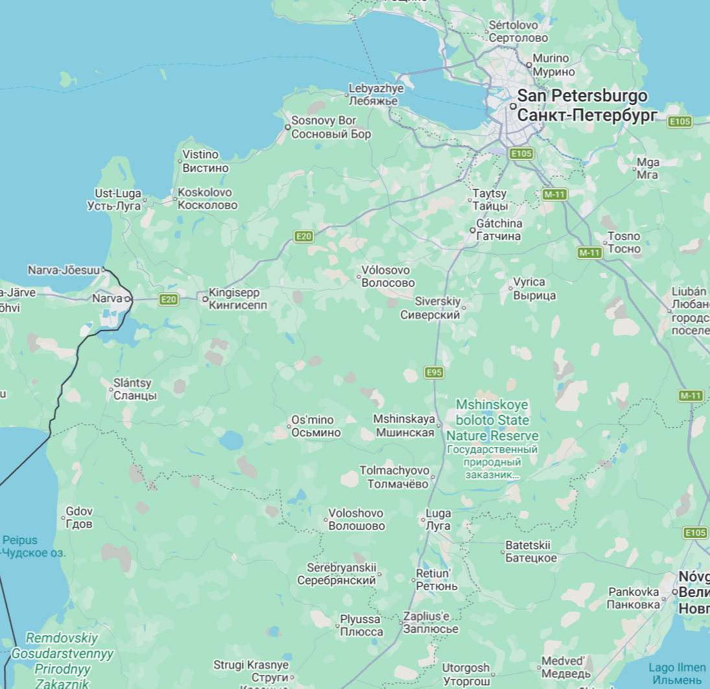
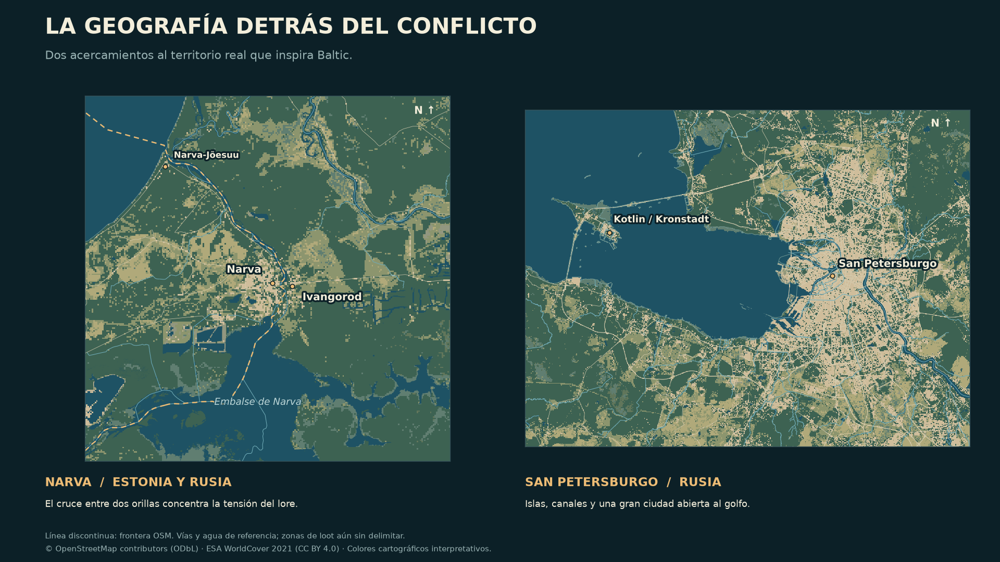

# Baltic — DayZ al otro lado de la frontera

**Dos orillas. Dos arsenales. Un territorio en disputa.**

Un mapa de **12,288 × 12,288 km** para DayZ, inspirado en el noroeste de Rusia
y la frontera con Estonia. Del golfo de Finlandia a **San Petersburgo**, una de
las grandes urbes rusas; de sus islas y canales a **Narva**, donde un río separa
dos mundos. Bosques, humedales, embalses y corredores fluviales dan forma a una
región real condensada en unos **151 km² de superficie de juego**.



*La zona que inspira Baltic. Captura de Google Maps aportada por Guillermo:
San Petersburgo al noreste, Narva al oeste y, entre ambas, costa, ríos, bosques
y humedales. Las distancias se condensan para DayZ.*

## Narva: la frontera que se convirtió en frente

En la **historia alternativa de Baltic**, la OTAN y parte del bloque del
Pacto de Varsovia se disputan este rincón del Báltico. Narva concentra la
tensión: sus cruces, el río y los accesos a ambas orillas convierten la ciudad
fronteriza en un punto clave del conflicto.

Cuando llega el colapso, quedan las huellas de esa guerra: posiciones
abandonadas, rutas de abastecimiento interrumpidas y material de procedencias
distintas. Para quien sobrevive, cruzar al otro lado significa buscar otro
equipo, exponerse en un paso disputado o encontrar una ruta por el agua.

La ambientación toma su identidad del territorio real. El conflicto pertenece
al lore ficticio del mapa y no representa la situación histórica o política actual.



*Narva está en Estonia; Ivangorod, en la orilla rusa. San Petersburgo y Kotlin
aportan la referencia urbana y costera. Vías, agua y frontera proceden de datos
geográficos; estos mapas no representan zonas de loot ya implementadas.*

## La experiencia que estamos construyendo

- **Cruzar de Este a Oeste tiene un propósito.** La visión del loot distingue
  armamento y equipo de origen oriental y occidental, para que cambiar de zona
  abra otras posibilidades de abastecimiento. La distribución y los tiers se
  definirán durante el diseño de la economía.
- **Los ríos forman parte del viaje.** Cauces navegables, embalses y conexiones
  con la costa para desplazarse en embarcación, transportar equipo y elegir
  accesos distintos a los de las carreteras. Profundidad, continuidad y paso
  bajo puentes forman parte de los criterios de aceptación.
- **Una gran urbe frente a una frontera tensa.** San Petersburgo aporta la
  escala urbana, sus canales y el Neva; Narva concentra el cruce entre ambos
  territorios y el peso del conflicto.
- **Naturaleza con identidad báltica.** Bosque denso, claros, humedales y agua
  abierta para alternar orientación, cobertura y exposición durante el recorrido.
- **Geografía reconocible a escala DayZ.** Costa, localidades y conexiones
  parten de fuentes reales. El terreno se adapta a la jugabilidad con una
  transformación común del área, conservando sus referencias principales.

## Estado del proyecto

**En desarrollo · EV112 · actualizado el 26-10-2026.** Hay terreno generado,
bosque colocado y pilotos de cauce continuo. Se están corrigiendo y verificando
orillas, relieve, colisiones y conexiones. Los controles de terreno de las
carreteras pasan en el ámbito medido; las carreteras físicas, la conducción y
la navegación completa siguen pendientes de validación en juego.

La colisión C del río 131 supera **4.749 controles de servidor y 300 rayos
adicionales**, con **1.449 componentes frente a 2.245** de la base U2. También
pasan **269.968 consultas sobre 3.727 árboles** y **11 secciones de carretera**
antes fallidas. Son resultados de servidor en el ámbito muestreado; la vista
y la conducción siguen pendientes. [Pruebas, rechazos y límites](evidence/v31-pond-layer-2026-10-13/ev112/visual-review-20261023/quality-continuation-20261025/README.md).

El candidato **kit-7: 1,66 km de cauce continuo** pasa coste y contacto completo
en fuente y PBO: **127.528 → 8.623 componentes**, con la geometría de charcas
anterior intacta. Ya está integrado en el WRP fuente y el bosque: **292 conflictos
retirados y 1.623 apoyos ajustados**, con carreteras y contexto forestal comprobados.
El paquete combinado declara sus **201 piezas** y ya pasa **11.052 mediciones de altura**
y **269.968 muestras de apoyo en la frontera** en el motor. La sonda de agua/colisión mide6.801puntos: detecta19fallos de contacto del kit7,
ya localizados para corregir; navegación y vista conjunta siguen pendientes. [Pruebas nativas y límites](evidence/v31-pond-layer-2026-10-13/ev112/visual-review-20261023/kit7-native-20261026/README.md).
[Integración técnica y límites](evidence/v31-pond-layer-2026-10-13/ev112/visual-review-20261023/kit7-integration-20261026/README.md). **C/F ya pasa 45 consultas de navegación en servidor**,
incluidas 8 rutas sobre el terreno corregido; movimiento real de IA pendiente.
[Prueba de navegación y límites](evidence/v31-pond-layer-2026-10-13/ev112/visual-review-20261023/c-navigation-20261026/README.md).
[Pruebas, costes y límites](evidence/v31-pond-layer-2026-10-13/ev112/visual-review-20261023/kit7-cost-contact-20261026/README.md).

El mapeado urbano, la economía de loot Este/Oeste y su progresión son parte de
la visión pendiente de implementar. La comparación de rendimiento con Chernarus
sigue abierta. **Todavía no hay una versión jugable con aceptación global.**

La imagen principal es la captura de referencia aportada por Guillermo. Los
acercamientos y el [mapa regional del recorte](docs/images/baltic-region.png)
se han generado con datos de **© OpenStreetMap contributors** y **ESA WorldCover 2021**;
[procedencia, créditos y reproducción de las imágenes](docs/images/README.md).

Nuevo candidato de relieve E: **59 picos y 12 depresiones corregidos**, manteniendo
la huella del agua y las reservas de carretera. Compilación y sonda de
**4.401 puntos en servidor superadas**, junto con **159 pruebas automatizadas**;
revisión visual pendiente. [Comparación y controles](evidence/v31-pond-layer-2026-10-13/ev112/visual-review-20261023/hybrid-relief-20261025/README.md).

Piloto F: corregida una transición rectangular junto a Narva, con **165 tests**
y controles de agua y carreteras superados. Conserva E y supera **4.749 controles
de servidor, sin fallos**; quedan cuatro transiciones por resolver. [Evidencia y límites](evidence/v31-pond-layer-2026-10-13/ev112/visual-review-20261023/rectangle-pilot-20261025/README.md).

Navegación de E compatible con DayZ 1.30: las **37 rutas anteriores y ocho
rutas locales nuevas superan la sonda**. El primer intento de navegación F terminó
sin una malla válida; C/F ya dispone de la malla y las 45 consultas indicadas arriba.
Siguen pendientes la locomoción y la cobertura global.
[Evidencia de navegación](evidence/v31-pond-layer-2026-10-13/ev112/visual-review-20261023/quality-continuation-20261025/README.md).

Comparación de servidor vacío con Chernarus: **16,8 % menos RAM residente y
15,6 % menos memoria privada**, con tres pasadas por mapa y poca dispersión.
Revisión independiente del lector; la suite actual alcanza **230 tests**. La CPU varió mucho; estos
resultados todavía no acreditan FPS ni capacidad multijugador.
[Mediciones y límites](evidence/performance/server-baseline-ab-20261025/README.md).

## Desarrollo y documentación

Este repositorio reúne código, herramientas de calidad y evidencia de desarrollo.
El historial público es independiente del local; los datos y builds grandes se
identifican mediante manifiestos. Ver [PUBLICATION.md](PUBLICATION.md).

- Estado vivo y siguiente paso: [HANDOFF.md](HANDOFF.md). Historia: [HANDOFF-history.md](HANDOFF-history.md).
- Producto y criterios: [product-spec.md](product-spec.md). Problemas: [bugs.md](bugs.md).
- Plan vigente: [corrección de ríos y relieve](plans/ev112-shape-repair-20261025.md).
  El estado concreto y las excepciones están en HANDOFF.md.
- Auditoría de agua y suelo: [evidence/v29-water-color-audit-2026-10-02](evidence/v29-water-color-audit-2026-10-02/summary.json).
- Desarrollo en `P:\DayZ_Baltic_12km_dev` (`subst` de `C:\Users\guill\OneDrive\Documentos\DayZ Projects`).
- Fuentes y atribuciones: [licenses/sources.md](licenses/sources.md).

## Repetición local

Python 3.12.14 aislado, con dependencias fijadas en `requirements.lock`. El entorno
está fuera de OneDrive y su intérprete base vive en la caché de runtimes de Codex
(`C:\Users\guill\.cache\codex-runtimes\codex-primary-runtime\dependencies\python`).
Hay copia de ambos en el checkpoint de E:\.

```powershell
& 'C:\Users\guill\Documents\Codex\2026-09-29\vamos\work\gis-env\Scripts\python.exe' -X utf8 'P:\DayZ_Baltic_12km_dev\tools\run_pipeline.py'
```

Ejecutar solo en una copia de generación: reemplaza `derived/` y sincroniza `source/`.
Los retoques futuros deben vivir en capas separadas antes de regenerar. No
sobrescribir un `source/` editado a mano.

El comando no descarga. Usa los 21 originales fijados por SHA-256 en
`evidence/source-manifest.json`, guardados en
`C:\Users\guill\Documents\Codex\2026-09-29\vamos\work\phase0\raw` (1,2 GiB) y
copiados al checkpoint de E:\. `--acquire` permite volver a adquirir fuentes, pero
una descarga nueva de OSM `latest` puede cambiar la instantánea y exige revisar el
manifiesto. Las rutas absolutas del manifiesto son de esta máquina.

`run_pipeline.py` produce la base de fase 0. El candidato V29 sale de encadenar los
solvers de `tools/navigation/` sobre intermedios fijados por hash en
`tests/regional_*`; todavía no hay un comando único desde las fuentes. El
checkpoint conserva esos intermedios.
