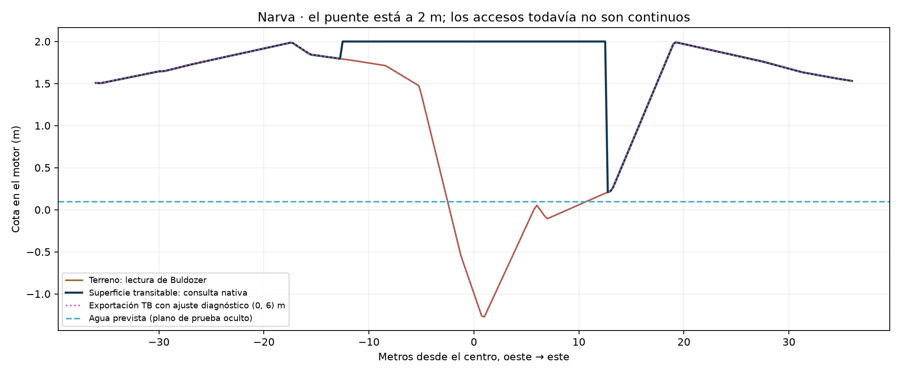

# Narva: ensayo de terreno, puente y agua

29-09-2026. **Lectura V3 recibida: ambos accesos a 2 m, sin desnivel medido.** El proyecto regional permanece intacto. Este ensayo aún no acredita paso con jugador, agua interior funcional ni rendimiento.

## Resultado

La lectura manual F10 de V2 permitió aislar un desfase de una fila entre la interpretación previa de la vista TB y las alturas consultadas por Buldozer. El tablero del puente vanilla estaba correctamente a 2 m, pero el acceso este quedaba aproximadamente 1,8 m por debajo. Se corrigió una copia del terreno usando el registro medido en el motor, sin desplazar el mapa regional ni modificar sus polígonos de agua.

La variante corregida cambia 202 vértices dentro de un radio de 48 m. Fuera de ese radio conserva las alturas originales. Su regeneración produjo exactamente el mismo SHA-256; las 4.194.304 alturas de la exportación auténtica de TB coinciden dentro de 0,00501 m, tolerancia motivada por el redondeo a centímetros del exportador. El control negativo con el terreno original es rechazado (salida 1; error máximo 2,4458 m).

| Comprobación | Resultado | Evidencia |
|---|---|---|
| Terreno original y proyectos regionales preservados | PASS, 569 ficheros sin diferencias | [Preservación](evidence/preservation.json) |
| Serialización del terreno corregido en TB | PASS, 4.194.304 muestras | [Exportación](evidence/verification-v2.json) |
| Rechazo de un terreno sin la corrección | PASS del negativo: resultado FAIL esperado | [Control negativo](evidence/negative-original-terrain.json) |
| Registro nativo en Narva | Medido, 289 puntos de ajuste + 289 puntos de perfil separados | [Comparación](evidence/engine-comparison-v2.json) |
| Tablero del puente a 2 m | Medido en V1/V2 con ModelToWorld y SurfaceRoadY | [Sonda V2](evidence/narva-probe-v2.log) |
| Accesos corregidos de 8 m de ancho | PASS V3, 34 extremos a 2 m | [Manifiesto de preparación](evidence/candidate-v2-manifest.json) |
| Guardado tras restaurar la cota del puente | PASS pose/alturas del WRP exportado tras reabrir | [Estado del checkpoint](evidence/checkpoint-state.json) |
| Agua interior, colisión y cruce con jugador | INCONCLUSO / no ejecutado | PBO compilado; no cargado en juego |

El estado `PREPARED_NOT_IMPORTED` del manifiesto describe el momento de generación, no el estado actual: la importación posterior está acreditada por `verification-v2.json`. No convertir las predicciones del generador en pruebas de motor.

## Registro y puente

**Contrato observado solo en este sector:** para la malla 2048²/6 m, `X=200000+6*col`, `N=6*(2047-row)`. La interpolación que reproduce el motor usa la diagonal NW-SE en el array con filas hacia abajo. Error máximo en la cuadrícula: 0,004900 m; en el perfil reservado: 0,004864 m. La interpolación bilineal con el mismo desplazamiento llega a 1,0747 m de error; la otra diagonal a 2,1522 m. La fórmula anterior `N=12288-6*row` corresponde a la observación visual previa y no debe usarse para predecir estas alturas nativas. No se ha demostrado un contrato global para otros tamaños/versiones ni corregido la producción.

Puente `dz/structures/roads/bridges/bridge_metal_25.p3d`, escala 1, centro TB aproximadamente (202417,143; 6889,885), yaw 98,748926°. El origen absoluto TB 1,476612 m sitúa el tablero a 2 m. El origen que devuelve el motor es distinto por el centrado del modelo: Y=-6,054884 m y roadway cruda Y=8,054884 m. **No pasar la altura local de autoría 0,523388 a ModelToWorld**: pertenece a otra base.

Después de reconstruir el terreno, TB volvió a `Follow elevation` y cambió la altura del puente. Se restauraron la cota anterior y `Keep absolute position`, se volvió a seleccionar para verificarlas y se guardó. Inspeccionar otra vez después de cada rebuild; no inferir persistencia de la selección previa.

Esta figura muestra **el fallo medido antes de corregir**, no el resultado final V3.

## Agua y renderizado: pendientes separados

- Pond vanilla visible: dos ejecuciones terminaron con excepción fatal C0000005 al desconectar. Pond oculto: tres ejecuciones posteriores terminaron normalmente. Es asociación reproducida por visibilidad; no se aisló el mecanismo del crash.
- El pond permanece oculto. No atribuirle el agua que aparece al excavar por debajo de cero: V3 consulta clasificación mar/pond y profundidad para distinguirlo. El WRP reabierto registra el origen del pond a Y=-0.0753505975 m; no acredita una superficie de agua funcional.
- Pasar de cuatro a seis materiales por celda no eliminó las manchas negras. La copia actual conserva seis materiales como variante de diagnóstico; no es una solución validada.
- `P:/bin/config.cpp` y el modelo del pond coinciden por SHA-256 con los extraídos de la instalación actual. Las fechas antiguas no prueban datos obsoletos. Solo se contrastaron esos dos archivos; scripts, texturas y materiales completos quedan fuera de esta comparación.
- El tracker oficial describe un caso de manchas corregido al emparejar datos y Tools de la misma rama. Es una pista para aislar el problema, no la causa demostrada de este proyecto. [BI T194105](https://feedback.bistudio.com/T194105), consultado 29-09-2026.
- Persisten avisos de skeleton Sakhal, CloudsEffect, PluginItemDiagnostic y recursos al cerrar. Los RPT normales no acreditan un arranque limpio.

## Reanudar

Proyecto: `P:/DayZ_Baltic_12km_dev/tb/narva_trial/narva_trial.tv4p`. Copia V1 anterior: `work/narva-sector/native-v1-backup` en el workspace de esta conversación. Los binarios nativos se conservan en el ZIP incremental, no en Git. Requiere la base del paquete regional previo y los assets vanilla instalados; no incluye modelos/texturas vanilla extraídos.

1. No repetir F10: V3 recogida, verificada y sondas retiradas. Buldozer terminado; WRP de proyecto reabierto contrastado. `checkpoint-state.json` conserva el estado histórico previo a V3.
2. Consultar el nuevo [paquete de prueba](../playtest/README.md): PBO compilado y misión independiente preparada. El conector DayZ MCP rechaza su consulta de estado por approval policy never; no se ha lanzado el juego ni adquirido lease.
3. Tras recuperar el canal autorizado, verificar registro/despliegue por hash y probar carga, cruce, agua/render. No extender correcciones al mapa regional a partir de este ensayo.
4. CE, navmesh y carga 80–100 permanecen separados. La sonda automática de la misión elimina la necesidad de otra pulsación manual.

APIs verificadas en scripts vanilla locales: `scripts/3_Game/global/game.c:1162` SurfaceY, `:1163` SurfaceRoadY, `:1176` SurfaceGetSeaLevel, `:1181` SurfaceIsSea, `:1182` SurfaceIsPond, `:1183` GetWaterDepth; `scripts/3_Game/entities/object.c:869` ModelToWorld. Consultas de superficie no equivalen a una simulación de movimiento del jugador.

## Identidad

- Fuente: `fa7878e26a63accce0f0a0a55b503ae1125f1fac9caa95fec4168c5d749de7f0`.
- Candidato corregido: `1326175fa0a53db2c69fba7e13767a57f7cb4475defaa5d32d8e55fe1a2b4856`.
- Exportación nativa V2: `beba1691236f558e6900c99b26e5fb6cc8b248540840a843486d0605d2f6fd8d`.
- Registro geométrico y pruebas: [carpeta de evidencia](evidence/).

No se descargaron nuevos geodatos, no cambió el recorte aprobado ni la escala XY, no se publicaron cambios y no se repitió el council completo. Una consulta pública posterior a Gemini quedó incompleta por timeout; no se adoptaron afirmaciones sin verificar.

## Lectura V3 recibida — 29-09-2026

**PASS de alturas nativas locales.** V3 de las 14:17:50: 289 puntos de cuadrícula, 289 de perfil y 34 puntos sobre ambos extremos. Máximo error de predicción 4.900 mm/2.519 mm; ambos extremos de ancho 8 m están a 2 m, sin desnivel medido respecto al tablero. Registro fijado por V2, sin reajuste a V3. La fórmula norte anterior falla hasta 3.9 m.

La consulta clasifica el centro como mar (`SurfaceIsSea=true`, `SurfaceIsPond=false`). El nivel observado fue 0.54377 m; GetWaterDepth se consultó a Y=0 y **no mide aquí la profundidad hasta el lecho**. No es una aprobación de agua elevada.

Buldozer terminó normalmente a las 14:20:05 (tercera terminación normal con pond oculto). Persisten avisos y tres objetos de script sin liberar; no declarar arranque/cierre limpio. Las dos sondas temporales se retiraron comprobando sus hashes; recibo `evidence/probe-cleanup.json`. No solicitar más F10 para esta prueba.

El WRP exportado después de reabrir pasa las 4.194.304 alturas y la posición del puente. Primer PBO compilado/verificado: ver el paquete de prueba. Faltan carga en juego, paso de jugador/vehículo, agua elevada, IA/loot y rendimiento. La petición de continuar hasta 1.0 no convierte estos resultados parciales en una versión terminada.
