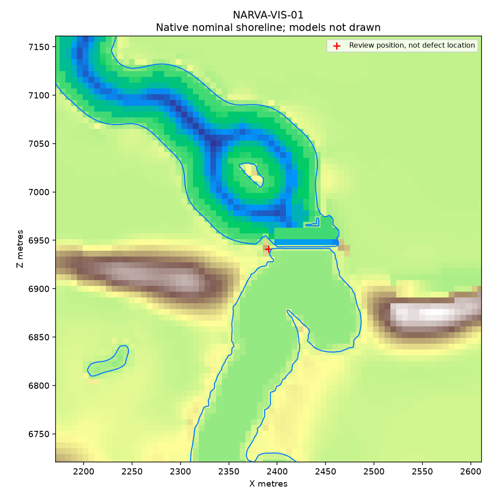
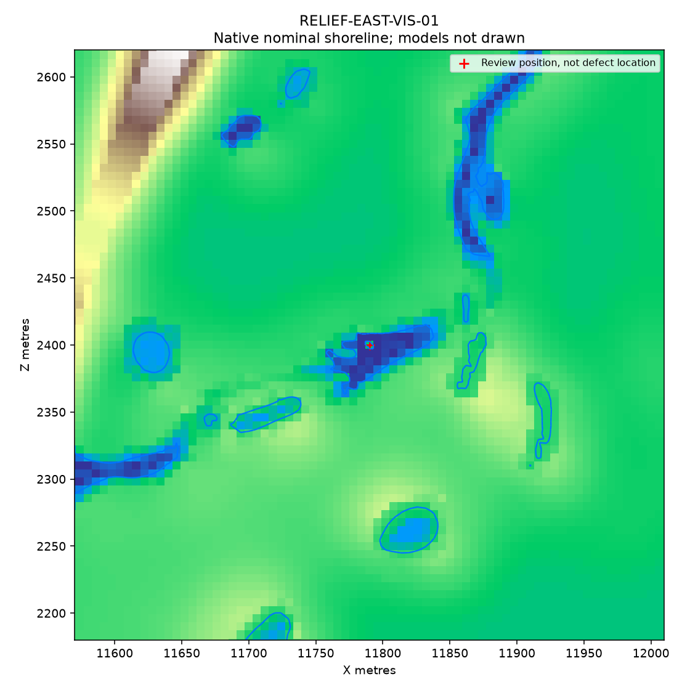

# Censo completo de orillas nativas — 28-10-2026

**Inventario verificado; mapa todavía rechazado visualmente.** Se reanuda el
trabajo autónomo tras finalizar Guillermo la visita. C1 queda SIN REVISAR.
La unidad añade detección y evidencia, todavía no modifica terreno ni modelos.

Se consumieron el terreno `815ef8b7…` y footprint `084171b0…` de la fuente
Kit7Nav8Load1 visitada. El censo recorre 4.190.209 celdas / 8.380.418 caras y
reconstruye **107.641 segmentos, en 1.030 cadenas**. Cada cara mixta está presente
una sola vez; cada segmento pertenece a una sola cadena. Un consumidor separado
comprueba aristas y coordenadas baricéntricas: residuo máximo 1,93e-12 m frente
al límite 1e-9 m. No se compara una transformación consigo misma.

## Resultados que no se ocultan

- 5 discontinuidades de posiciones bajo la misma clave de arista, hasta
  **1,0646 m**. Son diferencias entre campos de agua que requieren adjudicación;
  no se han soldado ni atribuido automáticamente a un fallo visual concreto.
- 4 caras con un vértice exactamente en el agua; 2 segmentos nulos; una cadena
  DEGENERATE. Este caso no recibe PASS de forma.
- El screen conserva POLICY `ev112-shapes-3`: 793 cadenas con candidatos,
  236 sin hallazgo en esos patrones y una degenerada. **793 no significa 793
  defectos confirmados**, y ausencia de hallazgo no acredita naturalidad.
- El censo original dejó 3 cadenas fuera del screen por coste. Una segunda
  lectura de esas cadenas ya guardadas completó el screen en 1,313 s, con los
  mismos umbrales y 42.337.062 pares. El informe original se conserva.
- No se evalúa el giro que cierra una cadena, la ocultación por modelos,
  los puentes, conducción, navegación ni RAM. Tampoco se certifica regularidad
  circular o naturalidad universal. Todos esos gates siguen abiertos.

## Correlatos de las observaciones

El contorno292 de Narva es una L entre X2429,56–2443 y Z6965–6973,24, con
giros de90° y hasta105,59°. Sus18 vértices incidentes están en la máscara Narva.
Hay coincidencia morfológica y de zona con la captura; la posición del personaje
por sí sola no registra una imagen sobre el mundo. No se elimina esa protección.
`shore_ramp_v31.base_protection` incluye Narva: aplicar el suavizador existente
sin revisar el soporte de la presa no puede corregir este caso.

El contorno769, X11757,75–11837,85 / Z2363,49–2415,36, presenta entrantes
angulosos junto al islote772. Es el correlato geométrico de la zona oriental a
contrastar con la captura; registra19 giros de al menos45°, máximo132,64°.
Sus92 vértices incidentes no tienen platform/reserve/narva; otros requisitos
de agua, topología y vecindad todavía deben comprobarse antes de repararlo.

Los controles actuales de carretera tampoco cubren la petición de pasos:
`verify_roads_v30.py:4-5,78-79` excluye48m del agua,470m de Narva y18m de
extremos. Su PASS no certifica cruces. El siguiente censo de cruces debe partir
de la geometría completa carretera-agua, independiente de la lista de puentes.

## Piloto de orilla seca: efecto medido

Se comprobaron los64.857 vértices del NPZ, caps incluidos. Agua, XZ y metadatos
son exactos; cambian48.982 alturas. La mediana de altura sobre terreno nativo
baja de1,053 a0,861m; el máximo de1,811 a1,422m. En ambos hay61.506 vértices
por encima del terreno. **No equivale a exposición visible**: el terreno está
enterrado bajo el modelo y falta medir la transición lateral y su silueta.
El piloto sigue OFFLINE_CANDIDATE_ONLY, sin materialización MLOD ni aceptación.

## Validación y revisión

20 fixtures positivas/negativas pasan: celda analítica, agua inclinada, H==W,
NaN, dimensiones incompletas, omisiones, duplicados, cruces desplazados,
asignación de cadenas, degeneraciones y presupuesto explícito.
Fable5.1 por CLI nativo revisó plan (SOUND-with-fixes) y código (SOUND).
La revisión no sustituyó las pruebas: dos corrupciones adicionales reproducidas
por Codex pasaban el primer consumidor. Se corrigió en una sola ronda exigiendo
dos aristas distintas y que cada una separe seco/mojado; ambos repros ya rechazan.
Fable no revisó de nuevo esa corrección mínima; las20 fixtures y el censo completo
son evidencia posterior sobre el código final. No se presenta como segunda review.

El censo único terminó en7,36s totales y446.562.304 bytes de pico de memoria
(426MiB), bajo600s/2GiB. Entradas y código fijados por hash, sin cambios durante
la ejecución. No se abrió DayZ ni se alteró el banco compartido.

## Siguiente unidad

Adjudicar los correlatos nativos y diseñar una reparación por clase que conserve
agua, extremos y topología. La L de Narva necesita distinguir apoyos de la presa
de terreno residual protegido; no autoriza editar toda Narva. La charca oriental
permite investigar el suavizado sin esa máscara, pero no salta los guards.
Completar por separado la envolvente de modelos y los cruces carretera-agua.
RAM, aceptación visual, reparación global y council ampliado siguen pendientes.
