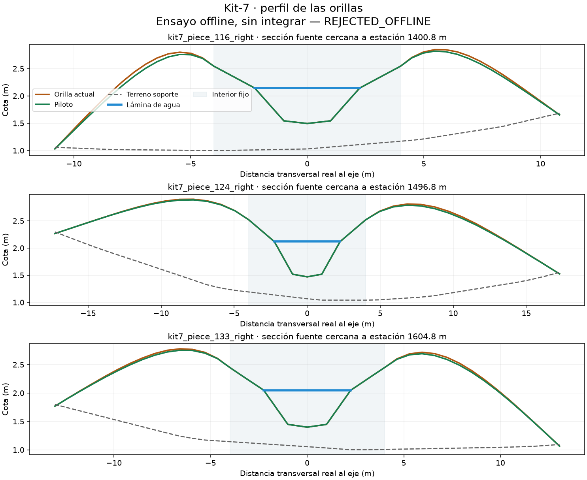

# Orillas de kit-7: atribución y piloto rechazado

Los14puntos archivados (7FAIL/7PASS) se atribuyen al delantal exterior q≈±6.
La altura fuente coincide con el Roadway nativo con error máximo4.84e-7m.
q es parámetro, no distancia física cuando la curvatura comprime el perfil.
La atribución localiza la superficie; PASS y FAIL comparten banda y no aísla
por sí sola la causa del generador. Se preservan Geometry, Roadway y agua aparte.

El único piloto de delantal4<|q|<18 queda **REJECTED_OFFLINE**. La energía discreta
de curvatura pasa561.733059→562.120487 (peor), aunque la pendiente máxima de
cara baja0.523794→0.510528. Solver345iter,97.84s de ejecución total,10testsPASS.
Bajada máxima7.8125cm. Las comparaciones con la navmesh vieja son descriptivas,
no una predicción ni prueba nativa. Ningún modelo, PBO, NM o despliegue nuevo.

La comprobación posterior descubre otra causa de rechazo:201puntos CAP que
debían permanecer exactos bajan hasta2.539cm. La puerta fixed_exact validaba
su propia máscara y no la promesa de conservar toda la transición de6m.
cap-postcheck.json contiene repro y hashes. No se reescribe el resultado ni se
repite el candidato. Ese falso alcance debe quedar entre los casos del council.

Fable5.1 revisó atribución, plan y código; revisión/adjudicación conservadas.
El fix previo del lector de floor incluye desplazamientoXZ por cuantización,
usando gradientes de las caras nativas. No cambia el floor del solver ni0.801.
Hay una limitación adicional del wrapper ante timeout, registrada explícitamente
en adjudication.json; este run terminó sin timeout y el candidato fue rechazado.

La siguiente hipótesis, revisada pero todavía SINimplementar, abarca toda la
orilla seca2.25<|q|<18 y conserva el lecho/lámina4.5m, protecciones yCAP≤6m.
Usará consumidor de ficheros guardados con mutantesCAP/lecho/water/XY/borde,
independiente de free. Plan: plans/ev112-dry-bank-domain-pilot-20261027.md.
Mantiene un solo candidato, peso.002 y500iter; sin barrido ni tolerancias menores.

Nav8 sigue607PASS/RAMFAIL; Load1RAM incompleto no se reabre. Los pendientes de
relieve, navegación, cliente/FPS/capacidad y council ampliado siguen abiertos.
