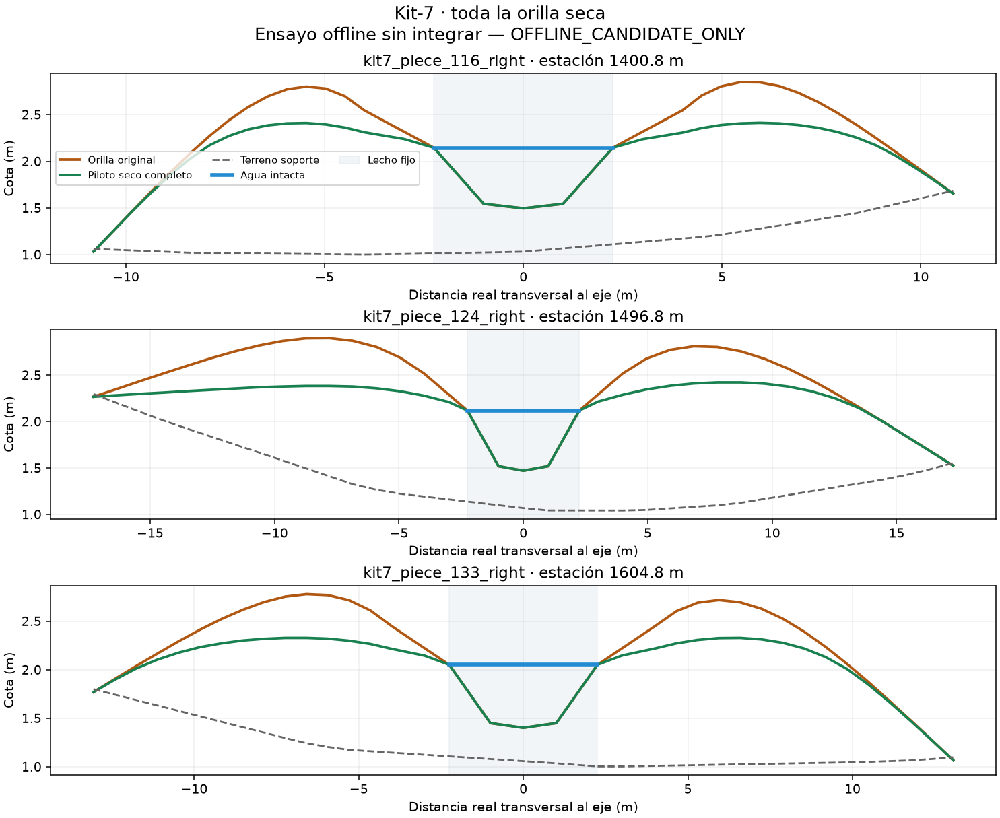

# Kit-7: piloto de toda la orilla seca

**REJECTED_OFFLINE**. Un candidato desde la fuente original, sin rebajar tolerancias.
Energía discreta 561.733058929 → 534.285533905;
500 iteraciones; 48982 vértices de altura cambiados.
Puertas fallidas: actual_visual_water_dry_floor.

El consumidor lee baseline y candidato guardados; deriva el lecho, CAP inclusivo
de seis metros, bordes, agua y XZ sin recibir la máscara del autor. Reconstruye
las protecciones desde fuentes congeladas. Agua/lecho/extremos no se aceptan
por una afirmación del generador. Los detalles por puerta están en execution/result.json.

Diez controles ejecutados: identidad sin mejora, mutaciones CAP interior, lecho,
agua, XZ, borde, techo, no finito, timeout y cero con signo. El test de mutación
de protección es **NOT_APPLICABLE**: este tramo tiene cero vértices que toquen
esas zonas. El primer test abortó por asumir que existía uno; se conserva ese
fallo y su única corrección. No se cuenta como cobertura protegida real.

Fable5.1 revisó el experimento por lectura y dio SOUND. La prueba real encontró
el supuesto anterior pese a esa revisión; ambos resultados quedan registrados.
El timeout devuelve124; exit0 del autor no sustituye el veredicto del consumidor.

Distribuciones respecto al nivel previo al redondeo: execution/result.json;
respecto al agua visual realmente guardada: analysis/visual-water-freeboard.json.
Se comprueba aparte que se conserva el margen seco previo contra esa agua visual.
El piso experimental
de0.025m no acredita P14, oleaje ni agua nativa. Las14coordenadas históricas se
conservan; sus comparaciones contra la navmesh vieja son únicamente descriptivas.
No se creó MLOD/PBO/NM, no se desplegó y no se utilizó DayZ MCP.
Nav8 sigue607PASS/RAMFAIL; RAM, navegación del candidato, vista y calidad global
siguen abiertas. El council ampliado continúa en cola tras el trabajo vigente.

El NPZ local se liga por SHA256 en los informes; no se publica como mapa validado.
Las fuentes de los scripts y los recibos están incluidos para auditar el ensayo.
