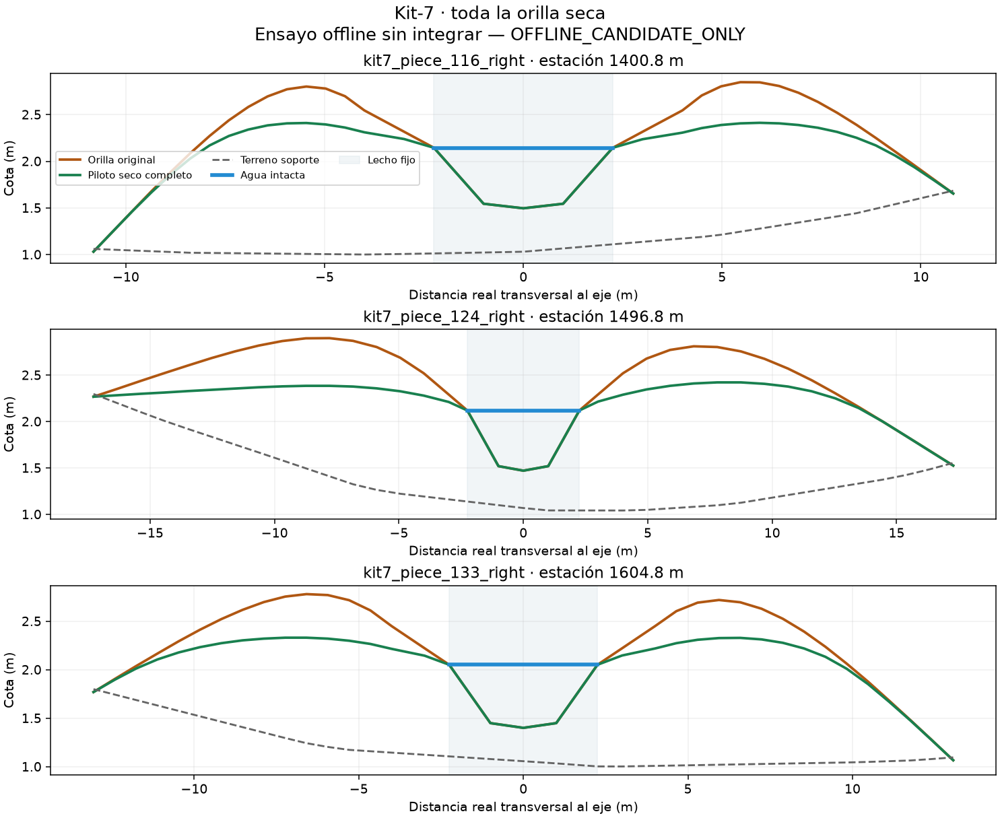

# Orilla seca completa: referencia de agua corregida

**OFFLINE_CANDIDATE_ONLY**. Se conserva exactamente agua, lecho, extremos completos
CAP≤6m, XZ y bordes. El margen seco se comprueba contra el agua realmente
guardada; los47.178puntos previamente secos conservan al menos0.025m.

Energía discreta: **561.733058929 → 534.272432327** (4.889% menos).
Ninguna pendiente máxima longitudinal, transversal o de cara aumenta.
Vértices cambiados: 48982; iteraciones: 500.
El límite de iteraciones no es convergencia ni aceptación por sí solo.

**12controles PASS y1NOT_APPLICABLE** (no hay vértices en zonas protegidas).
Incluyen mutantes de agua, extremos, lecho, XZ, borde, techo y no finito,
identidad sin mejora, timeout y bytes. Dos regresiones nuevas rechazan por
bounds tanto el candidato retirado como un solo punto con el fallo real.
Cuatro puntos originales que perdían el margen constan en adjudication.json.

El ensayo anterior df0c5994 queda REJECTED_OFFLINE: autor y checker compartían
una referencia errónea (level sin redondear). Un postcheck independiente lo
detectó pese al PASS inicial. Sus informes y pruebas se conservan en
../dry-bank-domain-pilot-20261027. Ese falso PASS no se reescribe ni se oculta.
Fable5.1 revisó el mecanismo y la sustitución antes de ejecutar la reparación.
No se cambiaron0.025/.02/.002/500 ni el dominio; se partió de la fuente original.

Esto valida geometría offline. **No es aceptación nativa, de navegación,
RAM, oleaje/P14, visual ni del mapa completo.** No hubo MLOD/PBO/NM ni despliegue.
Siguiente: materializar todos los LOD con colisión correcta, comprobar el paquete,
agua/forma/bosque y luego nueva navegación12.5/607consultas. RAM requiere seis
ABBAAB frescas si pasa la fase funcional. Mantener todos los límites actuales.
El council ampliado sigue en cola tras el trabajo vigente.
