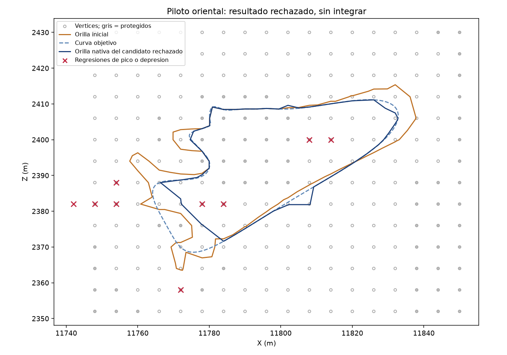

# Piloto de aguas pequeñas: controles validados, candidato rechazado

No se ha integrado ni desplegado terreno. C1 sigue sin revisión humana. La unidad
publicada añade controles y conserva un experimento rechazado reproducible;
no convierte el autor experimental en una reparación aceptada del mapa.

Los20controles positivos/negativos pasan: conectividad diagonal nativa,
componentes húmedos y secos con biyección, islote hundido, unión/división con
igual recuento, máscaras y dominio, esquinas pond actuales/potenciales, lado B,
pendientes y giros de cierre. Revisión Fable5.1 SOUND-with-fixes; corrección de
orden de pins reproducida con los datos reales y luego suite verde.

## Resultado del único candidato

| Medida | Resultado |
|---|---|
| Alturas modificadas |108; delta máximo2.455744m|
| Agua/islote |81componentes húmedos y28secos, biyección conservada|
| Otras orillas |107547segmentos exactos|
| Censo final completo |107611segmentos; todas las caras mixtas cubiertas|
| Pendientes |Sin regresiones de35°/.01°|
| Relieve |FAIL:3regresiones de pico y6de depresión|
| Giros de cierre y contorno |FAIL:10giros>=45°; máximo133.950658°|
| Ondulación p90 |FAIL:.328899m frente límite.191354m|

Dos depresiones nuevas aparecen en vértices cuya altura no cambia: revisar
sólo los vértices editados perdería ese fallo. Dos tripletas de intersecciones
congeladas conservan88.5354° y69.0152°; es un diagnóstico nativo, todavía no un
certificado de imposibilidad de la simplificación. La curva objetivo ya fallaba
con4giros; que una spline sea suave no prueba la orilla final de la rejilla.

## Límites y continuación

La instrumentación externa midió el launcher del venv (PID distinto del Python
real). Esos números de RAM están invalidados en execution-adjudicated.json.
La medición dentro del intérprete del diagnóstico de prominencia fue642326528B
residentes y1638989824B de commit; sólo corresponde a ese diagnóstico.
No se ha certificado el presupuesto RAM de la generación/validación originales.

Sin cambios de tolerancias, sin build, sin DayZ, sin navegación ni RAM contra
Chernarus nuevas. El candidato permanece rechazado. Siguiente plan propuesto:
[estudio de factibilidad](../../plans/ev112-water-constraint-feasibility-20261028.md).
El autor no debe relanzarse con el mismo contexto ni cambiar sigma para forzar
un resultado. Se conservan todos los fallos y fuentes originales locales.
