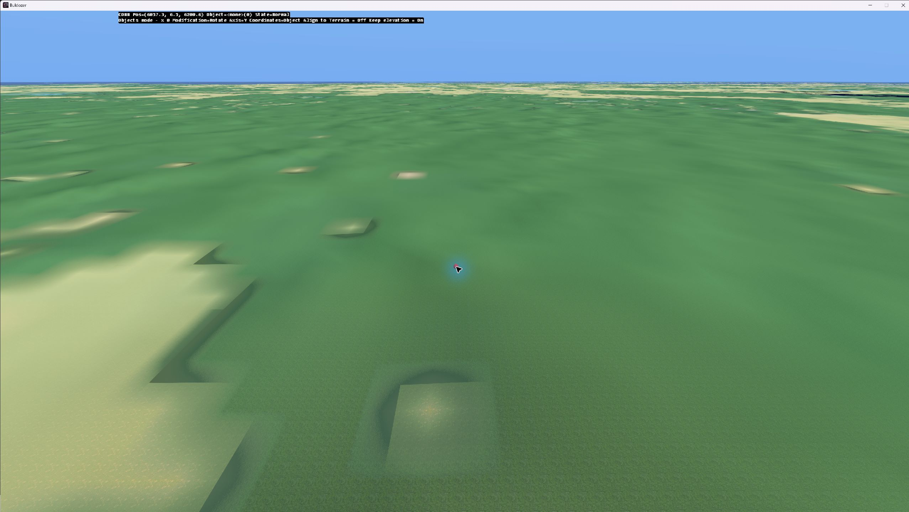

# El mapa ya abre en Terrain Builder y Buldozer

La base física de **12.288 × 12.288 m** está importada, generada y guardada en un proyecto nativo. Terrain Builder lo reabre y declara válidas sus capas; Buldozer muestra el terreno con textura. Esta prueba no elige el relieve final ni acredita todavía un mapa jugable.

[Paquete de los proyectos y fuentes](<C:/Users/guill/Documents/Codex/2026-09-29/vamos/outputs/baltic-importacion/baltic-terrain-builder.zip>) · [Recibo y SHA-256](<C:/Users/guill/Documents/Codex/2026-09-29/vamos/outputs/baltic-importacion/package-receipt.json>). Requiere los datos vanilla de DayZ en `P:\DZ`; restaurar sin sobrescribir ediciones posteriores.

## Comprobado el 29-09-2026

| Comprobación | Resultado |
|---|---|
| Fuentes del candidato | Los 53 archivos conservan sus hashes. |
| Probe de registro | 128², celda de 6 m; exportación con origen/orientación idénticos y las 16.384 alturas exactas. Controles NW/NE/SW/SE: 15/25/35/45 m. |
| Región completa | 2048², celda de 6 m; origen (200000,0), norte arriba. Las 4.194.304 muestras exportadas difieren como máximo 0,00500012 m del ASC fuente; tolerancia de exportación decimal: 0,00501 m. |
| Imágenes y materiales | `sat_preview` y `mask_preview` importadas; 25 pares de texturas PAA y 367 RVMAT generados. Todas las referencias no vacías a texturas existen. |
| Persistencia | `baltic_physical.tv4p` guardado y reabierto; TB muestra «All layers seem to be valid». |
| Buldozer | Conexión, creación del paisaje y render con textura observados. Desconectado desde TB; el proceso finalizó normalmente. |

Evidencia: [comparación de ASC](tb-roundtrip.json), [preflight](preflight.json), [rutas de materiales](material-paths.json), [parámetros](regional-samplers.png), [capas generadas](regional-capas-generadas.png) y [reapertura](regional-reabierto.png).

## Estado de los proyectos

- Regional: `P:\DayZ_Baltic_12km_dev\tb\baltic_physical\baltic_physical.tv4p`.
- Probe: `P:\DayZ_Baltic_12km_dev\tb\registration_probe\registration_probe.tv4p`.
- Las entradas GIS originales se conservan intactas. La variante de relieve ×3 sigue disponible para comparación, sin importar en un segundo mundo editado.
- La zona 31N de TB es solo el contenedor técnico de coordenadas de ingeniería; **no** representa la ubicación geográfica real. No reinterpretar el `.prj` exportado como UTM báltico.
- La carpeta de salida del marco con `registration-probe` fue rechazada; cambiando solo el guion por subrayado (`registration_probe`) TB la aceptó. Las rutas de los archivos fuente pueden mantener sus nombres originales.

## Límites y avisos abiertos

La prueba confirma que el consumidor TB acepta la base y conserva las alturas. **No resuelve la relación exacta entre centros del raster y vértices de la malla**: falta contrastar `sample_centres.shp` y controles sobre el terreno. No se ha aplicado corrección de media celda.

Durante la generación de capas, TB emitió mensajes `No entry` con texto ilegible y un `AssertNoDlg` en `CV4WGridImporter::LoadV4wGrid(44)`. Después completó la generación y reabrió el proyecto. La causa no está aislada. El [RPT de Buldozer](buldozer-prueba.RPT) contiene errores de ajustes, animaciones Sakhal, `CloudsEffect`, trazas de `PluginItemDiagnostic` y avisos al terminar; por ello el resultado es **render observado con incidencias pendientes**, no un arranque sin errores. El proceso terminó con `Termination successfully completed`; no hubo crash observado.

El agua interior, las carreteras y las ciudades siguen siendo referencias. No se importaron aún los SHP regionales ni se midieron seis anclas dentro de TB. No hay edificios colocados, WRP, PBO, CE, navmesh ni prueba con jugador. La capacidad para 80–100 jugadores sigue sin medir.

## Continuación concreta

1. Completar el probe de centros/vértices y las anclas regionales antes de colocar objetos de forma definitiva.
2. Aislar los avisos con el probe y un material de referencia, cambiando una sola dimensión por ensayo; conservar esta captura inicial.
3. Importar agua, carreteras y frontera como referencias y construir un sector pequeño de Narva: orillas, puente vanilla, accesos y edificios. Mantener un lago elevado y un canal del Neva como pruebas adicionales de agua.
4. Comparar relieve físico y ×3 sobre ese sector; después generar el mundo mínimo y probarlo con jugador. Sin expansión urbana masiva antes de comprobar agua y cruces.

El cruce comprimido de Narva mide unos **6,13 m sobre agua**, frente a puentes vanilla de 25 m o más. La [comparación de puentes](preparacion-narva.md) deja preparada esa prueba sin encoger edificios ni aprobar cambios de costa.

La navegación de Buldozer se contrastó con la [documentación oficial de DayZ](https://community.bistudio.com/wiki/DayZ%3ABuldozer_for_Terrain_Builder), consultada el 29-09-2026. El resultado de este informe procede de las capturas y archivos de esta máquina.
