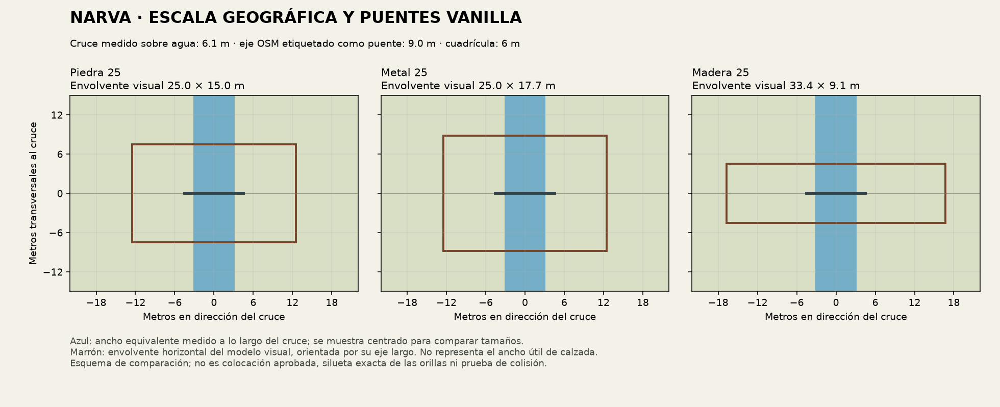

# Preparación de importación y cruce de Narva

El probe y el terreno regional están importados y guardados. Se verificaron las exportaciones ASC y una primera vista con textura en Buldozer. El [informe de importación](informe.md) recoge los resultados y los avisos abiertos. Esta comparación de puentes prepara el siguiente sector funcional; aún no hay puente colocado.

El preflight pasó de nuevo y los 53 archivos del candidato conservan sus hashes. Se midieron seis P3D vanilla ODOL v54 sin modificarlos: todos sus LODs pudieron leerse sin errores.

## Medición y consecuencia

La línea OSM del Puente de la Amistad, ways 4585846 y 1246405552, mide 9.02 m tras la compresión global. Su intersección con los polígonos de agua mide 6.13 m: aproximadamente una celda del heightmap de 6 m. Esto es una medida del vector; no acredita un canal excavado ni agua funcional en el terreno.

| Modelo vanilla | Envolvente visual horizontal | Envolvente horizontal del LOD Roadway |
|---|---:|---:|
| bridge_stone_25.p3d | 25.00 × 14.99 m | 25.00 × 11.89 m |
| bridge_metal_25.p3d | 25.00 × 17.68 m | 25.00 × 17.61 m |
| bridge_wood_25.p3d | 33.45 × 9.10 m | 33.28 × 8.03 m |

Roadway puede contener pendientes y superficies adicionales: su envolvente no es el ancho útil de una calzada ni prueba de transitabilidad. No se encogen los assets. La primera prueba debe medir apoyos, rasante, accesos y agua con un candidato real; no se ha elegido puente ni modificado la costa.

Fuente local de las clases: `DZ/structures/roads/config.cpp:27–45`. Geometría: P3D originales con SHA-256 en [bridge-dimensions.json](bridge-dimensions.json). Parser leído: `dayz-p3d-debinarizer/scripts/odol_reader.py:743` y desplazamiento de vértices documentado en `odol_to_mlod.py:95`.

## Prueba que queda preparada

Completar la medición centro/vértice en el probe guardado y contrastar las anclas regionales. Después ensayar en Narva apoyos, rasante, accesos y agua con un asset real. La variante física se importó para la prueba; ninguna elección final de relieve queda aprobada por esta operación.

[Preflight y hashes](preflight.json) · [Guía de importación existente](../../plans/terrain-builder-import.md)
