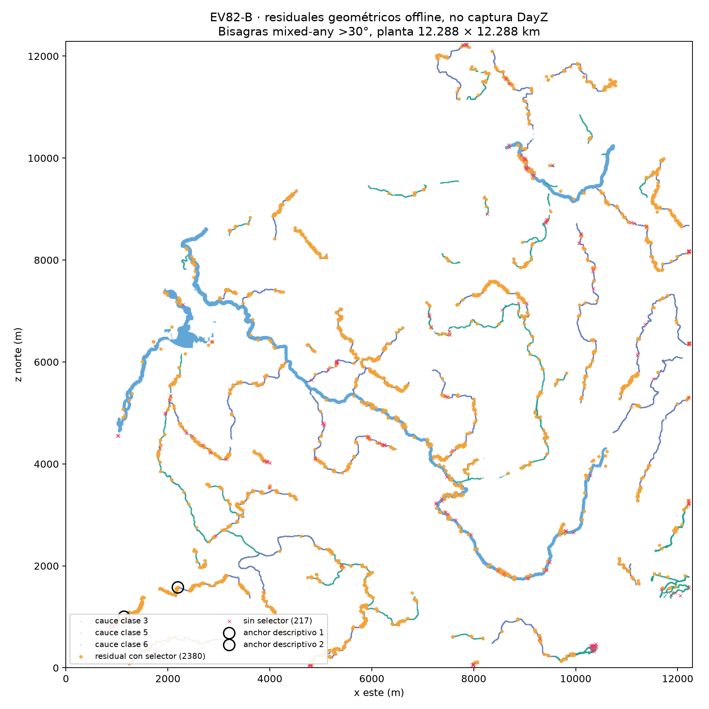
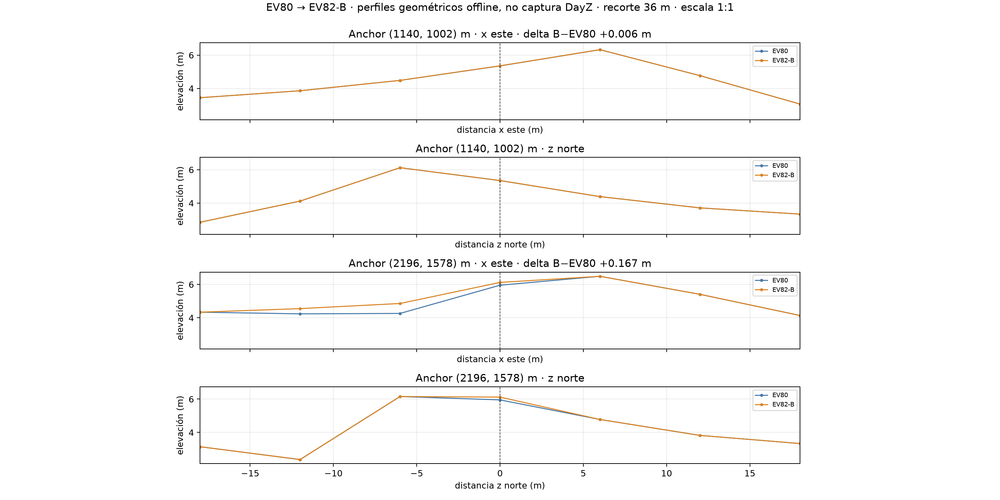

# Diagnóstico residual EV82-B

Candidato B SHA-256: `f9fb23decc6dbcfa2837b5bedcb02aea3eec44d2bbdc7b4c07d5d3f5fee061f0`  
Baseline EV80 SHA-256: `0a18c5623885eed274cfe7d296e02aba290ed491b835d317213fc7876b2fc45b`

Censo geométrico offline: residual = bisagra mixed-any (bank y wet support incidentes) con ángulo >30°. No diagnostica apariencia ni causa visual.

## Conteos

EV80: 3384 bisagras; EV82-B: 2597; reducción: 787.

|Orientación|EV80 >30°|EV82-B >30°|Reducción|
|---|---:|---:|---:|
|diagonal|2176|1697|479|
|vertical|605|438|167|
|horizontal|603|462|141|

|Participación de esquinas selector|Bisagras residuales|
|---|---:|
|no_selector_corner|217|
|selector_unchanged_only|625|
|selector_changed_only|1685|
|selector_changed_and_unchanged|70|

Razones de decisión registradas en esquinas selector incidentes; conteos por bisagra y solapados:
- `accepted`: 1755
- `benefit_below_material_floor`: 660
- `empty_hinge_component`: 36

## Margen escalar EV79 restante

En 2358 vértices selector únicos que tocan residuales: 2355 conservan >0.1m hacia arriba y 2358 >0.1m hacia abajo. Percentiles min/25/50/75/95/máx arriba `[0.0, 1.52782142162323, 1.7214629650115967, 1.8880149722099304, 2.0, 2.219374179840088]`m; abajo `[0.10434889068603459, 1.4095526384353634, 2.0, 2.2664040327072144, 2.6085187196731567, 3.0709781646728516]`m.

Esto mide espacio escalar dentro del presupuesto total EV79 y su suelo, no cuántos nodos superan límites angulares. No se hizo un segundo pase ni se creó candidato.

## Sectores más densos

|#|Sector 64×64|Bisagras|
|---:|---:|---:|
|1|29,2|80|
|2|16,15|49|
|3|17,28|38|
|4|31,13|38|
|5|28,3|37|
|6|29,15|36|
|7|10,12|35|
|8|6,23|34|
|9|29,3|33|
|10|15,14|32|

## Clasificador estricto y focos de perfil

El clasificador estricto de convergencia (vértice de banco, al menos 4 caras incidentes >30°, prominencia local ≥0.5m y bisagra residual) encontró **0** nodos. Cero significa que ninguna ubicación satisface esa conjunción exacta; no demuestra que no existan relieves piramidales bajo otra definición.

Los perfiles se centran en dos anchors medidos ya publicados por el consumidor, no en nodos seleccionados por el clasificador estricto: uno con la mayor reducción local de energía EV79→EV80 y otro con la menor entre los tres anchors. Son ejemplos descriptivos de residuales, no pirámides probadas.

- Anchor 1: (1140, 1002)m, filas/columnas (1880,190); elevaciones EV79/EV80/B 4.905/5.351/5.357m; B−EV80 +0.006m; caras locales >30°=0, prominencia 8-neighbors=+0.376m; bisagras residuales incidentes al nodo=2; selector=True (accepted).
- Anchor 2: (2196, 1578)m, filas/columnas (1784,366); elevaciones EV79/EV80/B 5.954/5.954/6.122m; B−EV80 +0.167m; caras locales >30°=0, prominencia 8-neighbors=+0.922m; bisagras residuales incidentes al nodo=2; selector=True (accepted).

Cada anchor tiene corte cardinal este-oeste y norte-sur con tres celdas de 6m a cada lado: 36m de ancho total. Los cuatro paneles comparten límites de altura y aspecto 1:1. Son perfiles, no la superficie triangular completa ni una captura de DayZ.

## Sondeo local del solver (sin aplicar propuestas)

Se llamó al solve_node existente en los tres anchors publicados por el consumidor EV82-B, con EV82-B como altura actual, EV79 como presupuesto/floor, EV80 como referencia angular y los mismos p99 de autoría. Las alturas están protegidas como solo lectura; ningún resultado se escribió. Es un sondeo del productor, no una verificación independiente del consumidor.
- (2196, 1578)m, actual 6.121625m; intervalo escalar EV79 -2.000000..+1.832778m. Referencia EV80: sin propuesta; motivo `benefit_below_material_floor`; sin propuesta que comprobar. Referencia B + p99 B (4.9821° banco, 3.6678° interior): sin propuesta; motivo `benefit_below_material_floor`; sin propuesta que comprobar; componentes angulares=28.
- (5538, 3918)m, actual 6.085515m; intervalo escalar EV79 -2.000000..+1.777307m. Referencia EV80: propuesta 6.234337m; motivo `accepted`; float32 directo=PASS. Referencia B + p99 B (4.9821° banco, 3.6678° interior): propuesta 6.177473m; cambio B +0.091957m; energía local 2685.817→2660.232 (0.953% menos); fallback 1 ULP; motivo `accepted`; float32 directo=PASS; componentes angulares=31.
- (1140, 1002)m, actual 5.356813m; intervalo escalar EV79 -2.000000..+1.548559m. Referencia EV80: sin propuesta; motivo `benefit_below_material_floor`; sin propuesta que comprobar. Referencia B + p99 B (4.9821° banco, 3.6678° interior): sin propuesta; motivo `benefit_below_material_floor`; sin propuesta que comprobar; componentes angulares=30.

## Redistribución de curvatura del banco seco

La energía angular incidente global baja 13.5% según el consumidor, pero el mean-square del banco sube de 1.38947688 a 1.42257046 (+0.03309358); el p99 apenas cambia (4.98207189° → 4.98207019°). La mejora no es uniforme: parte de la curvatura se redistribuye dentro del banco seco. El reporte etiqueta `ev81` al candidato, pero su `candidate_sha256` coincide con el SHA EV82-B.

## Clasificación de límites y lectura

El detector cuenta bisagras mixed-any de más de 30°. Facetas sub-30° y tramos rectos amplios quedan fuera; por tanto, este censo no cubre todo lo que el usuario puede percibir como rectángulo, pirámide o ribera facetada. Las bisagras sin esquina selector quedan fuera del alcance de esta pasada. Las que sí tocan el selector incluyen nodos editados y no editados; `benefit_below_material_floor` describe la decisión para esa altura, no demuestra imposibilidad. La segunda llamada al solver toma B como referencia angular y usa p99 B para medir libertad local restante respecto al estado actual; conserva presupuesto y floor EV79. El chequeo float32 directo recalcula seis caras y doce bisagras con productos vectoriales y productos punto de normales, además de floor, presupuesto y beneficio local. No sustituye los gates globales del consumidor.

Límites: offline; no render/LOD; los hits de máscaras se solapan; perfiles cardinales parciales; el solver local no es consumidor independiente. No se alteró terreno ni consumidor, no se creó candidato y no hubo paquete ni ejecución del motor.
