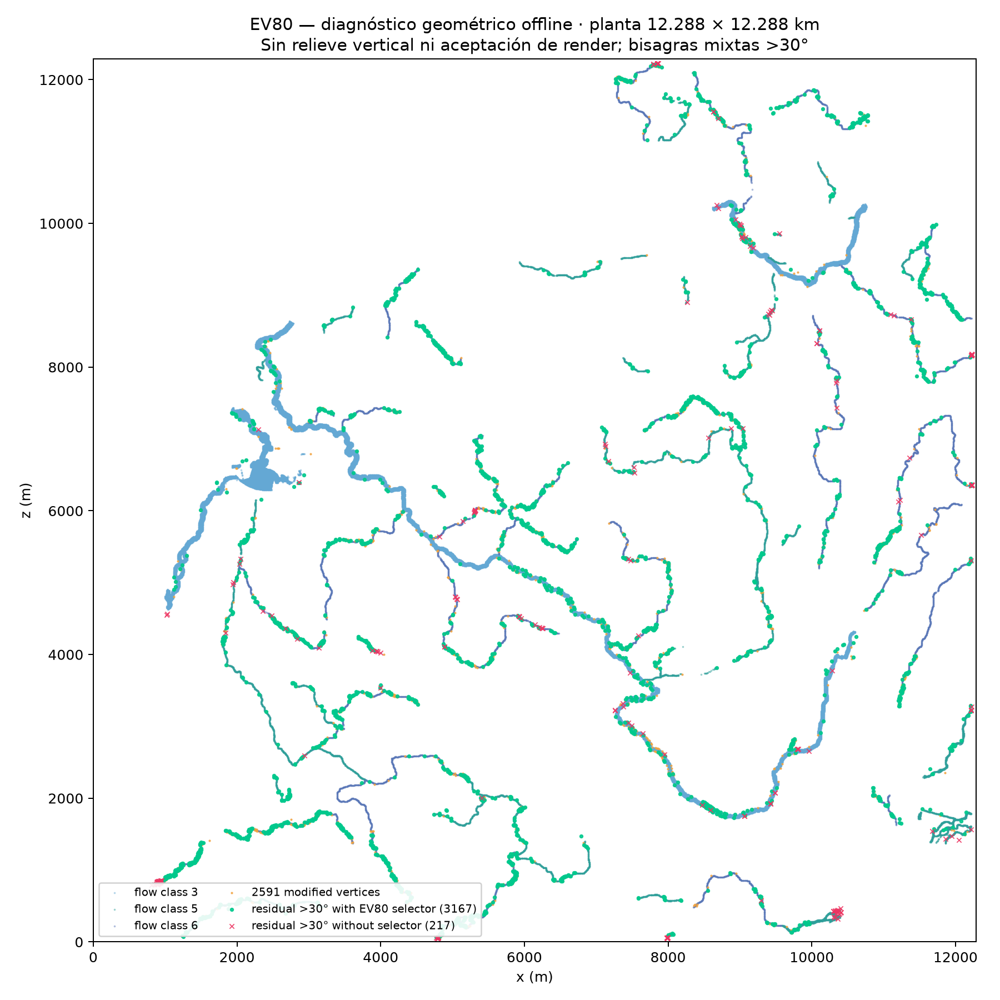

# Diagnostico residual EV80

Candidate SHA: `0a18c5623885eed274cfe7d296e02aba290ed491b835d317213fc7876b2fc45b`  
Consumer report SHA: `1f93c335d78d572de3a5c020c09d0cc397951cdb88b33f45ee1af144f3d0a60e`

Bisagra residual = ángulo candidato >30° y `mixed_any` del consumidor EV80: al menos una esquina de bank mask y una esquina de wet support de EV79. Esto es clasificación geométrica, no diagnóstico visual/render.

## Censo corregido

- Total: **3384** (diagonal 2176, vertical 605, horizontal 603).
- Con al menos una esquina perteneciente al selector fuente EV80: **3167**; sin esquina seleccionable: **217**.
- Estado de esquinas seleccionables: 1753 sin cambio aceptado en el barrido; 1325 con una o más esquinas ya editadas; 89 contienen tanto esquinas editadas como no editadas. Las cifras describen incidencia de extremos y pueden solaparse en los dos últimos estados solamente como definidos.
- Dos bisagras caen en la franja numérica `source<=30.0001°` y `candidate>30°`; el consumidor conserva su tolerancia/gate independiente.

## Qué bloquea las 217 sin selector

Todas las 217 tienen sus esquinas de bank que podrían pertenecer al selector protegidas por al menos una máscara semántica; los hits se solapan: halo de ingeniería 90, grandes lagos 59, borde 11 celdas 45 y controles temporales 25. Combinaciones exclusivas: halo 88, grandes lagos 59, borde 45, controles 23, halo+controles 2. Reserva/plataforma core no bloquean una esquina bank en este subconjunto; aparecen en 64 bisagras como contexto del lado húmedo.

Las 217 tocan wet support porque esa condición forma parte del predicado mixed-any. Eso no demuestra que haya que mover agua: su esquina seca del bank está fijada por las máscaras enumeradas. No se identificó un grado de libertad seco dentro del selector EV80 para ellas.

## Rechazos float32 de p99

El replay reproducible indica que los **1275/1275** rechazos `float32_bank_p99_rejected` pasan las seis pendientes, doce bisagras, p99 EV79, límites >30°, sector, suelo, presupuesto y beneficio tras mover la propuesta float32 **un solo ULP** hacia la altura previa; a dos ULP también pasan. El menor beneficio local rescatado fue 0.00020994, por encima de 1e-4. El productor redondea primero a float32 y hace un chequeo directo estricto `ángulo > p99 + 2e-8°`, con p99 banco EV79=5.004892938°. Así, estos 1275 son rechazos por frontera de cuantización local en su estado de visita, no falta demostrada de grado de libertad geométrico.

El replay completo dio exactamente las 2591 alturas EV80 (SHA256 del array: `80432d3751cea4a339c5b4df960a1aa1ebd6cdc83ca5cbc0e06fa637f6ae0ee1`). No se fabricó ni evaluó candidato ajustado con esos ULP; el acoplamiento al aplicar los 1275 a la vez sigue sin probar. Evidencia: [numeric-boundary-replay.md](numeric-boundary-replay.md) y [numeric-boundary-replay.json](numeric-boundary-replay.json).
## Diez focos conectados más densos

|#|N|pico (x,z)m|tipo/fila,col|ángulo|selector|
|---:|---:|---:|---|---:|---:|
|1|16|9003.0,7887.0|diagonal/732,1500|46.35°|16|
|2|15|897.0,834.0|horizontal/1907,149|55.22°|0|
|3|15|12219.0,8163.0|diagonal/686,2036|52.03°|7|
|4|14|12009.0,8739.0|diagonal/590,2001|52.37°|14|
|5|14|5937.0,1845.0|diagonal/1739,989|45.04°|14|
|6|12|4803.0,63.0|diagonal/2036,800|57.52°|2|
|7|11|12225.0,6357.0|diagonal/987,2037|54.64°|4|
|8|11|2037.0,561.0|diagonal/1953,339|47.24°|11|
|9|10|891.0,810.0|horizontal/1911,148|56.23°|0|
|10|10|4821.0,99.0|diagonal/2030,803|41.73°|10|

## Diez sectores 64×64 más densos

|#|Sector|N|pico (x,z)m|tipo/fila,col|ángulo|selector|
|---:|---:|---:|---:|---|---:|---:|
|1|29,2|82|891.0,810.0|horizontal/1911,148|56.23°|45|
|2|16,15|62|6027.0,5781.0|diagonal/1083,1004|49.42°|62|
|3|10,12|50|4905.0,8157.0|diagonal/687,817|46.66°|50|
|4|31,13|50|5079.0,303.0|diagonal/1996,846|44.86°|50|
|5|29,15|47|5841.0,1083.0|diagonal/1866,973|48.60°|47|
|6|28,3|42|1500.0,1299.0|vertical/1830,249|43.93°|42|
|7|17,28|41|10935.0,5481.0|diagonal/1133,1822|45.01°|41|
|8|29,3|39|1221.0,1083.0|diagonal/1866,203|47.32°|39|
|9|15,14|38|5463.0,6495.0|diagonal/964,910|47.97°|38|
|10|17,5|38|2103.0,5595.0|diagonal/1114,350|46.91°|38|

## Límites

- `selector_no_edit` significa que los vértices seleccionables incidentes no cambiaron en la pasada; no demuestra que otra delta factible no exista.
- Las causas de máscara son por intersección con extremos y no atribuyen causa única por bisagra.
- Esta figura y los conteos son geometría offline: no describen color/forma de píxel ni prueban corrección visual de DayZ.
- No se modificaron terreno, candidato, authoring ni máscaras consumidoras; solo se actualizaron este JSON, Markdown y figura diagnóstica.

