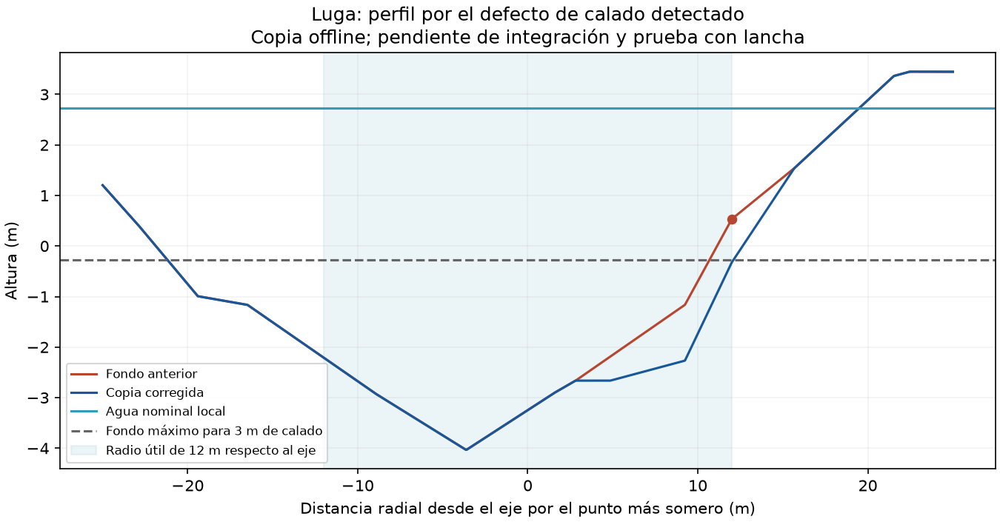

# Luga: reparación offline del calado, sin Computer Use

02-10-2026. Se conserva el mapa desplegado `69140d41` / agua `e9b52b8c` /
navmesh `24baf069`. Esta continuación no controla ventanas ni cambia el juego.

**Resultado:** copia de terreno preparada y validada offline. El corredor
auditado del Luga pasa de 2,192866 m a 3,030104 m de calado mínimo al rebajar
23 vértices de agua, con un máximo de 1,498746 m. No se ha desplegado ni probado
con lancha. BALTIC-012 sigue abierto en la versión instalada.

## Evidencia y límites

- `audit.json`: 36.488 caras de 19 partes conservadas; 170.433 vértices de
  intersección. El Luga incumple en 43 caras el criterio de 2,99 m. Todos los
  polígonos útiles auditados quedan dentro de sus polígonos aprobados.
- El evaluador recorta cada triángulo NW–SE por el canal de 24 m y comprueba
  todos los extremos afines, con la regla existente de plano de agua por celda
  y mar mínimo 0,5 m. La línea de intersección incluye ambas caras adyacentes.
  Plano analítico y obstáculo somero comprueban el cálculo. No usa un resultado
  positivo de la misma transformación como única prueba.
- Ámbito excluido: primeros/últimos 24 m de cada eje, partes demasiado cortas,
  Narva a menos de 620 m, fuera del mapa y los ejes antiguos del delta. El delta
  nuevo todavía necesita una referencia y pruebas propias.
- `candidate.json`: primer intento, límite de rebaje 1 m, inviable. No produjo
  candidato. `constraints.json` identifica cuatro restricciones incompatibles
  con ese límite. En la peor, 42,81 % de peso de orilla seca y 57,19 % de fondo:
  hacen falta al menos 1,49875 m de rebaje uniforme de los vértices libres.
- `bounded-bed-fix/candidate.json`: segundo intento, límite explícito 1,55 m,
  criterio de calado sin relajar. NPZ `1117b4b11b38e9369ea8ad7179cd3bbbde0517e19a714968357b25fc166b36e0`.
  Máscaras, agua, vértices secos, plataformas y Narva idénticos. Solo se baja fondo.
- `bounded-bed-fix/precision-control.json`: el candidato ya estaba generado
  cuando falló una comparación entre aritmética float32 y float64 (diferencia
  0,000000221 m). Se aisló esa diferencia y se compararon los mismos valores con
  aritmética float64 en ambos métodos; error 0,00000000000137 m. No se cambió
  tolerancia, altura ni solución. `finalize_candidate.py` verifica el archivo
  existente sin resolver ni escribir el candidato otra vez.
- `bounded-bed-fix/terrain-gates.json`: PASS; 416.633 celdas sin incoherencias,
  tierra seca y profundidad genérica válidas, Narva idéntico. El gate genérico
  exige 0,10 m, por eso se necesita además el comprobador de canal útil.
- `bounded-bed-fix/road-gates.json`: PASS, 100 cadenas / 76.536 estaciones;
  caída transversal máxima 0,027403 m, pendiente 6,2461 %, cuerda 0,024754 m.
- `bounded-bed-fix/export.json`: ASC de 42.599.157 bytes, SHA `cb4b3b8f783ddd1c7c286765dc9027c4fa1b2958feb6760bed2b1a12f3d70725`,
  relectura exacta. Desplazamiento máximo calculado de línea nominal de agua
  0,04248 m en 54 cruces afectados; cuatro caras mixtas nuevas superan 35°.
  Los vértices secos siguen idénticos. Esto no certifica render ni oleaje.

## Archivos y reproducción

Candidato: `E:/DayZ-Baltic-Build/v30-fairway-candidate-bounded/terrain_v30.npz`
y `baltic_terrain_v30_fairway_candidate.asc` en la misma carpeta.

Intérprete: `C:/Users/guill/Documents/Codex/2026-09-29/vamos/work/gis-env/Scripts/python.exe`.
Desde la raíz del repo, con carpetas de salida nuevas para conservar evidencia:

```text
tools/terrain/audit_fairway_triangles_v30.py --out <evidencia-nueva> --candidate <candidato-nuevo.npz> --max-lowering-m 1.55
tools/terrain/verify_terrain_v30.py <candidato-nuevo.npz> --json <terrain-gates.json>
tools/terrain/verify_roads_v30.py <candidato-nuevo.npz>::heights <candidato-nuevo.npz>::water --json <road-gates.json>
```

Las puertas existentes escriben su veredicto en JSON: un código de proceso 0
no sustituye comprobar `status`. El nuevo evaluador devuelve 2 si el candidato
es inviable o el diagnóstico sin reparación falla. Las fuentes ejecutadas de
los dos intentos quedan congeladas en `audit-run-v1.py` y
`bounded-bed-fix/audit-run-v2.py`; el verificador final está en `tools/terrain/`.

Antes de promover: revisar estas modificaciones junto con el suavizado pendiente
de Narva sur, reconstruir superficie/WRP coherentes, generar navegación nueva y
repetir agua, lancha, conducción y rutas del motor. La versión instalada no se
altera por una copia offline. No hay aceptación global de ríos ni capacidad de
80–100 jugadores; la prueba de carga sigue pospuesta a un sector mapeado.


