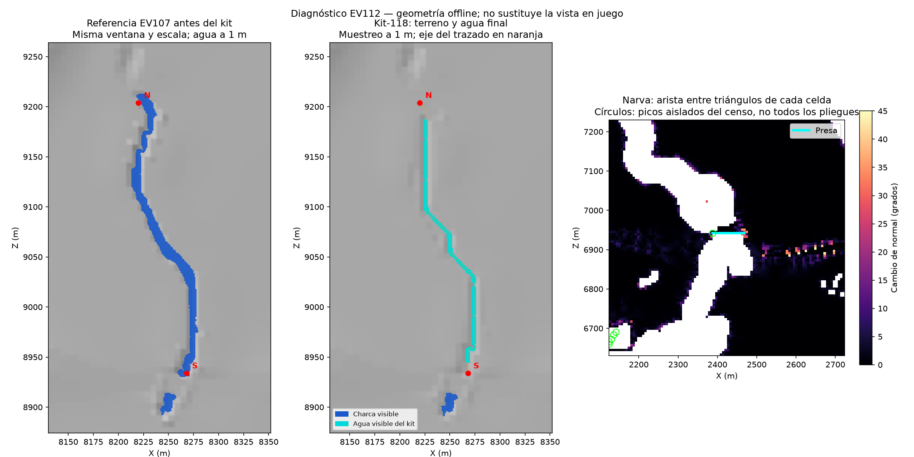

# EV112 — revisión visual rechazada; corrección general abierta

Guillermo ve ríos con codos y rectas desde media altura, un extremo ausente junto a kit-118 y terreno con picos/pliegues junto a Narva. También rechaza los dos salientes de lecho seco delante de la presa. Decide por picker **mar hasta el pie de la presa, con tierra solo en los apoyos laterales**.

La sonda previa sigue acreditando sus puntos concretos. No demuestra naturalidad del trazado ni cobertura de los finales originales. No hay nuevo build ni corrección integrada en esta revisión.

## Resultado medido

| Comprobación | Resultado y límite |
|---|---|
| Trazados del kit | 49 construidos, 2.897 giros de eje, 2.321 codos de 90 grados. Dos sitios mantienen charca y no tienen eje construido. No equivale al censo de todos los ríos de charca. |
| Kit-118 | 298,37 m, siete giros, recta máxima 102 m. |
| Extremo norte | En X 8130–8352 / Z 9189–9222, 246 m² de agua anterior y cero actuales, raster de 1 m. |
| Extremo sur | En X 8130–8352 / Z 8928–8943, 120 m² anteriores y cero actuales, raster de 1 m. |
| Cobertura de gates | G3 solo comprueba wet_span; G11 omite uniones de component. Kit-118 es component. No prueba las colas originales. |
| Censo global de prominencias | 111 vértices de pico y cinco de depresión en tierra >0,5 m. Son candidatos métricos, no 116 defectos independientes ni permiso para editar. |
| Aristas junto a Narva | 37 celdas secas con pliegue diagonal >20 grados en 600×600 m, máximo 46,72 grados. 20 grados es un intervalo descriptivo, no un umbral aprobado. |
| Lecho frente a la presa | Las 33 celdas retiradas de la capa de charca siguen secas sobre el mar de referencia a 0,75 m. La nueva decisión exige una capa explícita de batimetría. |

El dibujo interpola los triángulos nativos del terreno y usa las caras reales del agua del kit a 1 m; no es una captura del motor. Comparte lector geométrico con el generador y no se presenta como validación independiente. El panel de Narva mide solo aristas interiores de celda; no incluye todas las aristas entre celdas.

## Evidencia y continuidad

- `geometry-review.json`, `kit118-end-samples.csv`, `audit_visual_geometry.py`: inventario y diagnóstico reproducible. `pyramids/`: censo global, su script original está en tools/terrain/census_pyramids_v31.py.
- `narva-local-diagnostic.json`, `inspect-narva.py`: comparación del lecho final con la entrada de la presa y contrato por hash.
- `visual-feedback.json`: observaciones humanas, atribución y capturas. La cámara libre permaneció en Narva durante el primer traslado; ese defecto se atribuye a Narva. Tras salir, se repitió el traslado y se comprobó kit-118. Las capturas posteriores en un bosque no documentan el extremo ausente; el dato humano se conserva por separado de la medición offline.
- `MANIFEST.json`: identidad de esta copia. Originales en `E:/DayZ-Baltic-Build/v31-pond-layer-20261013/ev112-build-20261018/view-20261023/`.
- Plan de trabajo: `plans/ev112-visual-rework-20261023.md`.

Último run de visita: `6fbc010b-a3d5-44fa-bbe9-9ef967b1df3d`. El último session_status devuelve self none y banco sin runs ni procesos ajenos: la visita ya no está activa. Esta revisión no ordenó ningún cierre. No hay medición válida de FPS ni aceptación global de la ruta.
