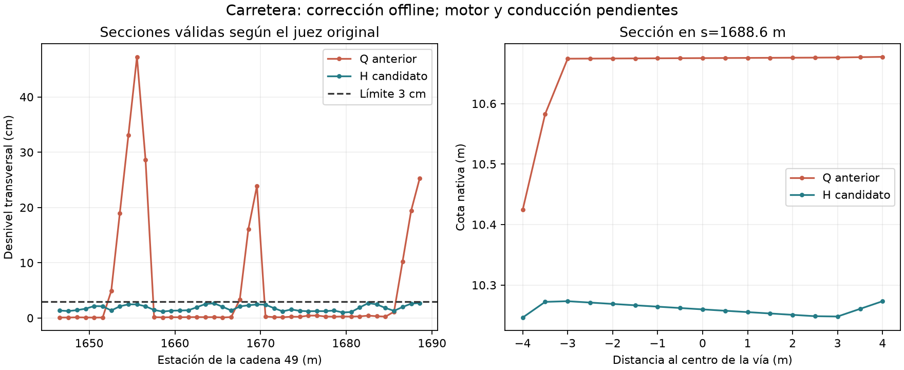

# EV112: continuación autónoma, carretera H y vista R

**R compilado, leído y desplegado aislado. Verificación offline PASS; motor y
aceptación visual pendientes.** Q sigue intacto y conserva su resultado histórico
786/786; ese resultado no se atribuye a R.

## Carretera

Los once fallos transversales de la cadena49 se corrigen en H, mediante64 vértices.
El consumidor original recorre102 cadenas/77.559 estaciones válidas y devuelve:
transversal0,027067569m (límite0,03), pendiente0,062467543 (límite0,065),
ondulación0,028033794m (límite0,03), cero fallos. Cero aristas nuevas/empeoradas
por encima de20°. Delta de altura[-0,504852;1,615022]m.

El contrato conserva las exclusiones originales:48m junto al agua,470m alrededor
de Narva y18m en extremos. No acepta cruces, encuentros, carreteras físicas ni conducción.

E/F/G fueron rechazados. El diagnóstico aisló dos problemas del productor:
protección indebida del borde de la misma carretera y restricciones impuestas
sobre estaciones excluidas por el consumidor. H conserva el collar36m y todas
las protecciones reales, comprueba la sequedad actual y usa la selección original.
La otra carretera más cercana está a975,57m del dominio. No se relaja el juez.
SLSQP no convergió a su margen interno más estricto; el float32 final sí cumple
los consumidores originales. No se afirma un óptimo matemático.

Bury recalculado: cero cambios adicionales y ninguna exposición nueva. Todas
las matrices de huella de agua quedan idénticas a Q; mar, objetos, kits, puentes,
Narva y disco015-45 exactos. Once vértices etiquetados como agua histórica dentro
del dominio se acreditaron secos; no se rellena agua real.

## Bosque, compilación y paquete

Solo se ajusta Y de54 elementos. Los2.578.822 registros conservan ID/modelo/XY,
rotación/escala y todos los bytes restantes; el no forestal es completamente exacto.
Soporte/separación de los2.560.922 elementos del bosque: cero fallos. G2/G3/G7/G8
conservan las entradas efectivas; forest-context-continuity.json prueba por qué se
mantienen los resultados anteriores. No son nuevas ejecuciones estadísticas ni
cero fallos en todas las ventanas de G2/G3 generales.

AddonBuilder terminó correctamente. Lectura completa del WRP compilado:
2.578.822 objetos,35 poses piloto exactas; un redondeo Y de2ULP en el mismo tronco
histórico pasa el consumidor independiente de raíz. Controles negativos de objeto
faltante, extra y desplazado rechazados. El lector de tabla compilada sigue siendo
heurístico y no decodifica sus alturas: la sonda de motor sigue siendo obligatoria.

Comparado directamente con Q, el PBO final cambia **solo baltic_trial.wrp**;
las otras6.826 entradas, config y propiedades son idénticas. Navmesh conservada,
antigua: no aceptada para el terreno nuevo y pendiente de regenerar.

Desplegado en `P:/Mods/@DayZ_Baltic_EV112_VisualReviewR/Addons`:

- Mundo: `234881855edd0529c4c899ed5e68c3517379588e857652132fbb6f3708a343c8`.
- WRP compilado: `2949173ce4fc5ff0903ca182b67583014ee693290ea03e94af7b1b324f4a91d2`.
- Piloto: `742fcc8d076df39a8c54cb99f86c3099976219afe00bc62561794f7cc701bec7`.
- Agua: `97edcafe1fc86d9abb4c3aa591d5081a6dd940b87020069fd45c04f8d0deae43`.
- Terreno tras bury: `d3d41a8b71253ce1eae427ade4b9a327bd44062a6f58a835cd79d01e48db8762`.

## Siguiente ejecución

En `B/personal-view-visual-20261024-r` (B es el build EV112) están las peticiones
`launch-server.json` y `launch-personal.json`, la ruta y los recibos con hashes.
La misión de servidor conserva init.c probado, cambia solo el CSV:786 puntos
anteriores +64 vértices nuevos +187 muestras de las11 secciones =1.037 puntos.
La vista personal conserva los16 archivos autorizados de la misión anterior.
Preflight offline y hashes desplegados PASS. No se lanzó ninguna misión nueva.

Usar `tools/water/eval_visual_road_probe_ev112.py` con points.json, log y referencia
de colisión vanilla anterior. Conserva el consumidor estricto Q y añade el rango
transversal medido≤0,03m de cada sección; dos pruebas específicas pasan, incluido
el caso donde cada altura está a<1cm pero el desnivel conjunto excede3cm.
Referencia vanilla: la misma calibración del checkpointC, nunca un margen inventado.

MCP130 sigue devolviendo daemon_unavailable. Tres intentos oficiales: el primero
rechazó nuestra ruta keyfile con separadores no canónicos; el segundo no acreditó
la generación; el tercero agotó el plazo de migración de identidad. Doctor confirma
servicio inaccesible y10 slots de backup preprune agotados; bundle/pins pasan.
No se ha aislado una causa única. No se modificaron claves/registro/backups ni se
cerró ningún proceso ajeno. Los bootstrap propios terminaron; sin run ni lease
propios. La ocupación del banco no se puede certificar con el servicio caído.

Cuando el servicio vuelva: session_status, lanzamiento tipado/adopción por protocolo,
sonda R y cierre propio; vista con foco humano, caminar/vehículo y navmesh nueva.
No ejecutar manualmente DayZ ni el servidor de datos para eludir el lifecycle.

## Rendimiento y pendientes globales

Auditoría de5.495 ODOL y capturador comprobado contra traza pública oficial en
`evidence/performance/chernarus-audit-20261024-d/README.md`. Benchmark DayZ/Chernarus
INCONCLUSO: no FPS, RAM/VRAM en juego ni capacidad multijugador medidos. R conserva
los mismos recursos/XY que Q; comparar R cuando se ejecute el A/B, con sus hashes.

Persisten revisión visual y caminar antes de expandir el piloto,66 candidatos de
extremos, dominios protegidos/picos,015-45 y271 labios previos; carreteras físicas,
conducción, navegación y rendimiento. Ninguna excepción aprobada se cambia.

Sin commit/push por integración y aceptación global abiertas. Árbol principal y
cambios ajenos preservados. Artefactos grandes permanecen en B; MANIFEST fija esta
evidencia. No actualización de memoria Codex compartida.
