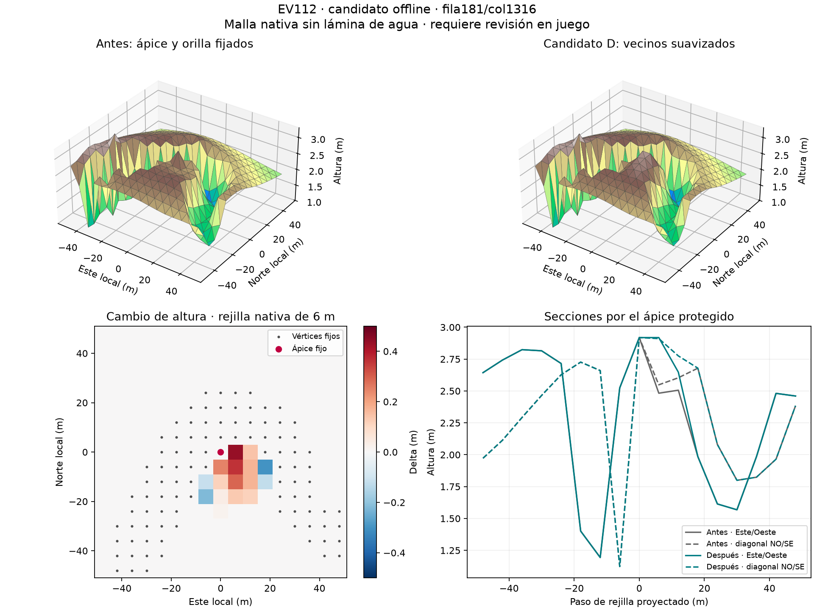

# EV112 — suavizado de vecinos de extremos protegidos

**Candidato D compilado y probado:4292 puntos de servidor PASS,0 fallos. Vista pendiente.**
58 grupos de picos y8 depresiones corregidos sin mover sus ápices protegidos.
1347 alturas cambiadas, delta máximo absoluto0,75m y alcance24m. El censo global
pasa de327 a269 picos y de1156 a1148 depresiones. Los5 patrones rectangulares
restantes son idénticos. Estos contadores son hallazgos del cribado, no una
certificación de naturalidad de todo el mapa.

## Verificación

- 148 tests ejecutados,0 errores y0 skips. El inventario CLI se ejecutó completo:
  máscaras y1483 grupos idénticos al descubrimiento original.
- Se conservan alturas protegidas, orillas, apoyos, reserva, islas, carreteras y
  el disco autorizado de60m de015-45. Huella de agua regenerada exacta y bury0.
- Control independiente de130 extremos protegidos afectados:0 nuevos sobrepasos.
  No aparecen picos, depresiones, pendientes o aristas nuevos o agravados según
  los consumidores. Energía pura local decreciente; no es una prueba de energía
  global ni de aspecto natural.
- P11:77559 secciones y130534 intervalos,0 fallos; máximo transversal0,0295013m.
  Solo reserva y geometría nativa; las carreteras físicas y la conducción siguen
  sin aceptar.
- 1484 alturas de árboles ajustadas.2578725 objetos contrastados:2577241 idénticos
  byte a byte y los demás cambian únicamente Y. Consumidor de suelo independiente:
  error máximo9,48e-7m. Reejecución del stage produce el mismo WRP.
- Bosque:2560872 instancias,0 fallos medidos de apoyo/agua/transformación;
  **3727 discos del borde INCONCLUSOS**, conservados como pendientes.

## Revisión y candidatos rechazados

Fable5.1 revisó el piloto, el lote y el cierre. PilotoA producía una corona;
se rechazó. LoteC controlaba solo los objetivos factibles: la revisión ampliada
detectó3 sobrepasos junto a otros extremos protegidos. Se conserva ese negativo
y D se regeneró con límites para todos los extremos protegidos cercanos.

De81 grupos potenciales,66 se aplican. Quedan15 sin aplicar:8 clústeres dan fallo
numérico de SLSQP y otro no reduce la energía. No se etiqueta un fallo numérico
como imposibilidad matemática. El diagnóstico posterior de restricciones
lineales distingue5 conjuntos de testigos incompatibles y3 factibles, sin
resolver por ello la condición no lineal de aristas.

La revisión final detectó un sombreado de argumentos en la nueva CLI de
inventario y metadatos heredados en stage-report. Corregidos: CLI ejecutada,
reproducción exacta, metadatos recalculados y campos heredados explícitos.
Autor y solver de D archivados y cotejados con sus SHA256. El primer stage falló
solo al emitir metadatos; sus bytes se verificaron, se recuperaron los metadatos
y se repitió completo tras corregir la herramienta. No se ocultó un fallo de
geometría ni se modificaron las alturas para pasar una prueba.

## Identidad y límites

Terreno base U2/T: `ab96a8f6fb3da6ca02e566caa1cf5d61ad720d340ec611316c33bcbe2ce717ef`.
Candidato D: `b0c7caaaf6b47d97074da0bb67667dd55e2e438f433e864049c3457287e909ac`.
WRP fuente: `81560aa2d6419be4c6091793795d515ca2fcf96750c58088d965777852607087`.
El delta guardado permite reconstruir exactamente las alturas sobre la base
fijada. Los grandes derivados se conservan fuera de Git, en
`E:/DayZ-Baltic-Build/shape-repair-20261025`.

Compilación D terminada:2578725objetos y62poses piloto contrastados, controles
negativos ausente/extra/movido detectados. MundoD SHAe78190d9e32f55824cc703950235ac69d3173dd2a6e02a9a488918a8833ab2f4.
Sonda ampliada4292puntos PASS: todas las1347 nuevas alturas y triángulos objetivo incluidos.
149 tests PASS al cierre del build. Run7b9c50cf cerrado ordenadamente y lease liberado;
cliente no lanzado. Vista personal preparada con el modD. Navegación U2 terminó TIMEOUT a3600s/74%,
sinarchivo, tresPBO intactos; servidor cerrado y lease liberado. No acepta D. Permanecen la vista conjunta, contactos del cliente,
otros ríos/relieves, bosque de borde, navegación y comparación con Chernarus.
La comprobación U2 anterior de2823 controles y300 rayos no se atribuye a D.
