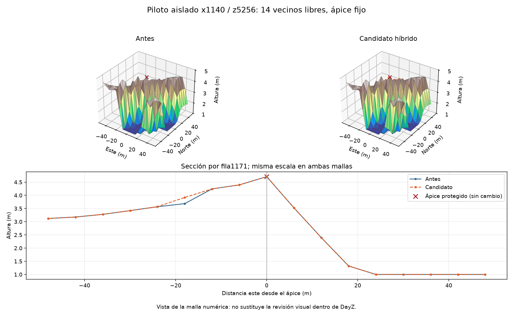

# Un pico protegido corregido en candidato aislado

El modo híbrido existente ahora puede trabajar sobre una base nueva, sin
requerir retener un candidato anterior. Se conserva el solver y todos sus
controles. La regresión real reproduce el fallo del modo por cotas y la
solución híbrida, con29tests correctos.

En x1140,z5256 se ajustan14vecinos libres, hasta0,594243m; el ápice queda fijo.
Su prominencia baja a0,299900055m y la energía pura de164,129606 a161,897188.
Las protecciones y coronas se rederivan y verifican; bury no añade cambios,
la huella del agua permanece exacta y pasan77559muestras de carreteras.
El censo completo del candidato pasa de268 a267picos; mantiene1144pozos y
4transiciones rectangulares. Esos hallazgos siguen abiertos.

Esto es validación offline de un candidato separado. No cambia el paquete
kit7 que se está generando/probando: allí siguen268picos. No acredita bosque,
composición WRP, compilación, motor, navegación ni inspección visual del
retoque. No se heredan las pruebas nativas del kit7 anterior.
Los CSV, fuentes, fixture y hashes permiten revisar el cambio concreto;
los grandes terrenos NPZ permanecen fuera de Git.
