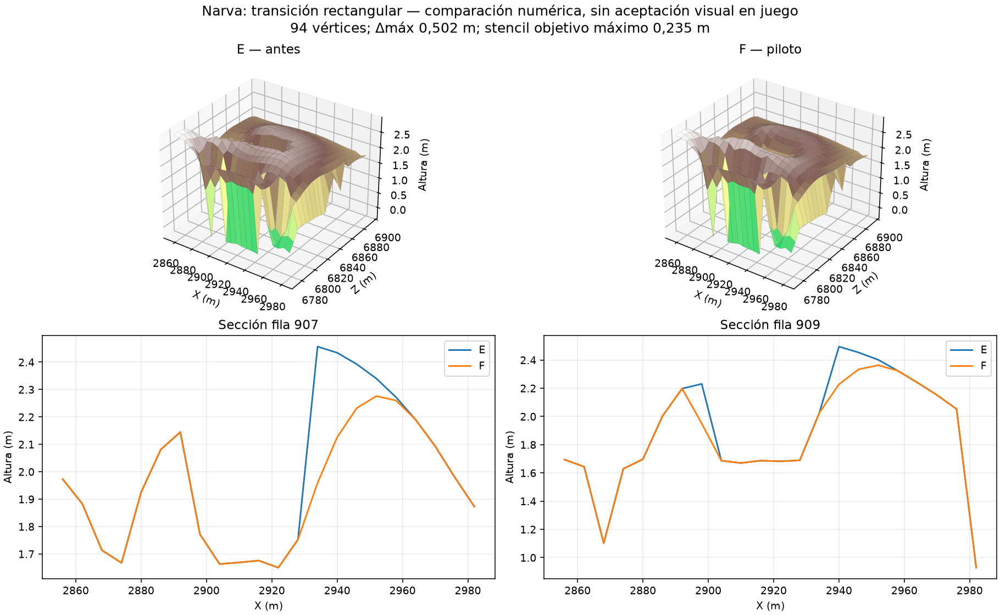

# EV112 — transición rectangular de Narva, candidato F

**Corrección offline verificada; compilación y motor pendientes.** El piloto
X2916/Z6834 suaviza94 vértices libres dentro de24m, con delta máximo0,502m.
Los máximos por eje bajan de0,363/0,435m a0,165/0,235m (EO/NS), bajo0,30m.
El censo global pasa de5 a4 transiciones rectangulares; las otras cuatro son
idénticas. Permanecen268 picos y1144 depresiones. Todos los cambios de D/E
se conservan exactamente. No se ha cambiado el detector ni sus umbrales.

165 tests PASS, con controles negativos de dominio, centros fijos, límites
firmados y comparación exacta del default contra el solver congelado de E.
Fable5.1 revisó plan y código: SOUND-with-fixes; correcciones documentadas.
Replay de terreno, máscaras y fixture byte a byte.

Agua: huella completa idéntica, bury0. Carreteras:77559 secciones y130534
intervalos sin fallos. Protecciones actuales recalculadas: cero ediciones
prohibidas y cero excesos alrededor de extremos protegidos afectados. Seis
vértices heredados de E cambian de clasificación libre por redondeo junto al
suelo de la envolvente; están fuera del parche y F los conserva. Se informa
esa diferencia, sin afirmar igualdad de máscaras.

Fuente WRP:2578725 objetos,59 ajustes de altura de árboles; restantes2578666
byte exactos. Error máximo de apoyo independiente4,64e-7m. El control completo de bosque mide2560872
instancias sin fallos y conserva los mismos3727 discos de borde INCONCLUSOS.
La compilación continúa. La navegación en cálculo pertenece a E;
no acredita este candidato F. Siguen pendientes vista, contacto cliente,
otras transiciones, ríos restantes y benchmark frente a Chernarus.

La figura muestra alturas numéricas; no es una captura ni aceptación visual
en DayZ. Los NPZ de fixture están en tests/fixtures/rectangle-narva.*.
MANIFEST.json fija cada artefacto de esta unidad.
