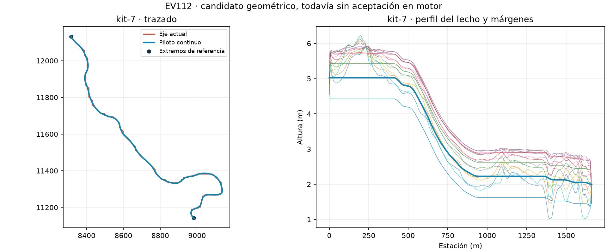

# EV112 — recuperación del reinicio y siguiente cauce, 26-10-2026

**Herramientas verificadas y candidato kit-7 comprobado offline; navegación C pendiente.**
El paquete C/F desplegado conserva su identidad y las pruebas publicadas de la
[unidad anterior](../quality-continuation-20261025/README.md). No hay aceptación global,
nuevo paquete ni prueba de cliente en esta unidad.

## Kit-7: cauce continuo guardado

El autor existente produjo 1.661,79 m de cauce en139modelos. La revisión independiente
de los MLOD comprueba ambos extremos originales, agua visual y `water_ext`, continuidad,
cero pliegues y127.528componentes de colisión cerrados. El control negativo detecta
la eliminación de la cola. [Resultado](rivers/kit7/saved-review/review.json).

Las3.430alturas modificadas mantienen las máscaras protegidas, carreteras, láminas
anteriores, reparaciones F y el disco015-45. No aparecen picos, depresiones ni
aristas fuertes nuevos. `envelope.npy` retira36celdas inactivas exactamente permitidas
por el autor; `cover.npy` y todas las celdas de charca activa permanecen exactos.
[Guardas](rivers/kit7/diagnostics/native-guards.json) y [capas](rivers/kit7/diagnostics/layers-and-cover-v2.json).

La revisión del lecho guardado encuentra0solape de área, una superficie conectada,
0aristas no manifold y0aristas del terreno afectado por encima de20°. De3.304aristas
del lecho por encima de20°, ninguna aparece expuesta en el muestreo de visibilidad.
**Visibilidad muestreada, sin aceptación estética ni prueba en motor.**
[Diagnóstico](rivers/kit7/visible-relief-review.json).

El primer plan del ejecutor importó incorrectamente el límite T±0,75 m del alisado
de relieve al soporte del río. La revisión Fable detectó el error de alcance; se
conservan el plan inicial y el diagnóstico condicional de475cotas incompatibles.
El límite sigue vigente en su dominio de relieve. La corrección no cambia el
candidato ni relaja sus protecciones. [Plan corregido](../../../../../plans/ev112-kit7-independent-validation-20261026.md).
De2.164vértices fuera de esa envolvente,1.337están bajo el lecho guardado,
815fuera de él y12dentro con una diferencia de hasta0,030175m por encima del lecho;
esto describe muestras puntuales, no la ocultación continua del terreno.

**Sin integrar:**1,826GB de fuente y127.528componentes requieren reducir el coste.
Quedan la huella/bury del agua nueva, bosque, compilación, colisión nativa,
navegación y revisión visual. El examen previo de10.0-0 no encuentra conflicto
de cotas;38.0-0 tiene887conflictos de hasta0,4m. Ninguno de esos dos cauces fue generado.

## Navegación C: fallo observado, causa pendiente

Tras recuperar P: desde la configuración real de DayZ Tools, se verificaron las
entradas congeladas. El helper de preflight tenía un SyntaxError; pasó una copia
local que solo corrige el literal. La fuente gobernada quedó intacta y se envió
feedback `fb-20261026-115953-61e9`. [Recuperación](recovery/recovery.json).

El primer arranque rechazó una diferencia de separadores de ruta antes de iniciar
el generador. Los cuatro hashes eran exactos; el proceso se cerró oficialmente.
Se corrigió la comparación y se realizó un único intento real sobre C/F:
`a2619a56-4b44-49f1-bb6f-da2a16da3f86`.

Un observador de solo lectura retuvo el handle del servidor35192 y registró su
salida−1 a las11:58:30UTC. El RPT muestra terminación a las12:58:30local. Había
heartbeats de lease a las11:58:25 y11:58:36; la intención de cierre propia llegó
después,11:58:41. El [último progreso](nav/c-failed/progress.jsonl) registra23% y
desconexión. **No se produjo una NM válida.**

La cancelación del generador propio se solicitó después de detectar la salida;
su retorno4294967295 no identifica por sí solo la causa. La limpieza oficial
retiró el run, pero su recibo no confirma cierre graceful. Banco libre, lease
liberado y ninguna limpieza pendiente. [Diagnóstico](nav/exit-diagnostic/diagnostic.json),
[observador](nav/c-failed/observer/terminal.json) y [limpieza](nav/c-failed/cleanup.json).
No hay prueba de crash, OOM, temporizador ni quién inició el cierre. El token
`EmoteTimeout` del arranque y el `timeout` del recibo de limpieza no establecen
una causa. Los canales Windows disponibles tampoco la identifican.

C45 conserva exactamente las45consultas previas, incluidas8para el parche F.
Preparación y código revisados; **empaquetado, despliegue y sonda C45 no ejecutados**.
Esas consultas tampoco acreditan atravesar las25piezas de colisión optimizadas C.
Los coordinadores de generación v1/v2 se archivan como evidencia histórica:
su espera de comandos largos debe corregirse antes de reutilizarlos. La versión
C45 ya contiene la corrección, probada con un fallo real demorado y cinco controles.

## Pruebas y límites

Suite completa actual: **230tests PASS**, incluido un control de salida negativa−1,
salida23, identidad errónea, ejecutable erróneo y timeout que conserva el proceso.
Siete controles del coordinador y tres mutantes rechazados; cinco controles C45
y fallo demorado rechazado. Fable5.1: SOUND-with-fixes, resolución explícita.
[Pruebas](tests/receipt.json), [revisión](reviews/final/review-response.json),
[resolución](reviews/final/resolution.json).

Siguen abiertos268picos,1.144depresiones y4transiciones del censo F, los restantes
cauces,015-45 y la aceptación de cliente/conducción. La comparación RAM con
Chernarus publicada pertenece a E; no acredita F/C ni FPS o capacidad multijugador.
Los resultados nuevos no modifican esos estados.

`MANIFEST.json` fija los bytes de la evidencia. Fuentes ejecutadas conservadas
también en gzip reproducible. Los2GB de modelos, terrenos y paquetes quedan
fuera de Git, ligados por hashes. El historial público se exporta separado del local.
